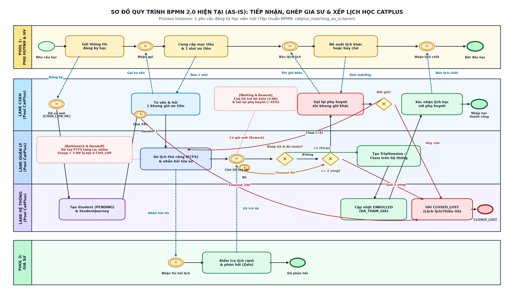
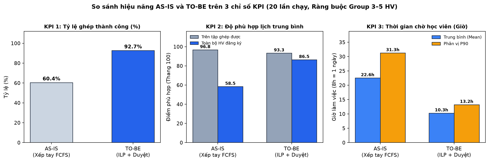
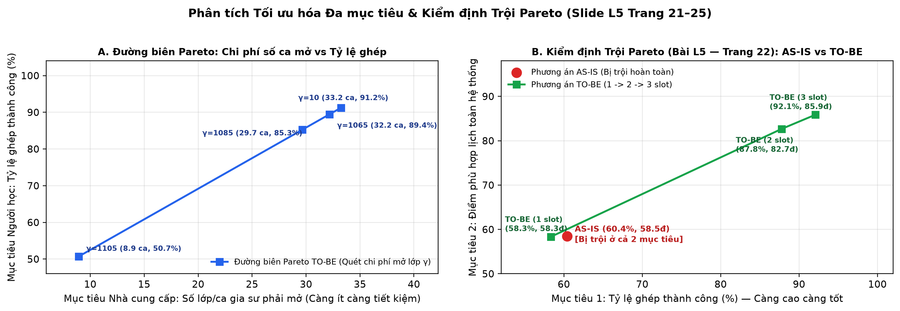
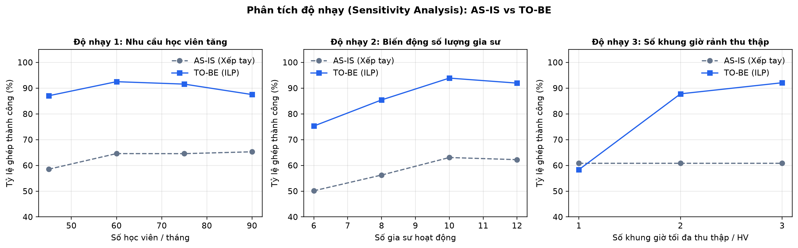

# BÁO CÁO DỰ ÁN CUỐI KỲ — HỌC PHẦN KHOA HỌC DỊCH VỤ (INT3501)

**ĐẠI HỌC QUỐC GIA HÀ NỘI — TRƯỜNG ĐẠI HỌC CÔNG NGHỆ**

## TỐI ƯU HÓA QUY TRÌNH GHÉP ĐÔI GIA SƯ – HỌC VIÊN VÀ XẾP LỊCH HỌC TRÊN NỀN TẢNG CATPLUS

*So sánh phương án xếp lịch thủ công cơ sở (AS-IS) và quy hoạch nguyên gom nhóm (MILP), kết hợp mô phỏng hàng đợi SimPy, trên hệ thống dịch vụ đào tạo lập trình CatPlus*

- **Nhóm 20** — Sinh viên thực hiện:
  - `23021941` — Phoutthavong Xayavong
  - `23020105` — Vũ Quốc Long
- **Địa điểm, thời gian:** Hà Nội, 2026

---

## Mục lục

<!-- TOC_START -->
- **1 Bối cảnh và câu hỏi phân tích** *(trang 1)*
  - 1.1 Vấn đề dịch vụ *(trang 1)*
  - 1.2 Phạm vi và câu hỏi phân tích *(trang 1)*
  - 1.3 Dữ liệu và chỉ số *(trang 2)*
  - 1.4 Cách tiếp cận *(trang 3)*
- **2 Hệ thống dịch vụ đào tạo lập trình CatPlus** *(trang 3)*
  - 2.1 Mô tả hệ thống bằng Work System Framework *(trang 3)*
  - 2.2 Bản đồ nguồn lực và đồng tạo giá trị *(trang 4)*
- **3 Quy trình hiện tại và chẩn đoán** *(trang 5)*
  - 3.1 Quy trình AS-IS *(trang 5)*
  - 3.2 Phân tích thời gian theo từng chặng *(trang 6)*
  - 3.3 Phân tích hàng đợi và tình trạng tồn đọng *(trang 7)*
- **4 Mô hình tối ưu ghép lớp và xếp lịch** *(trang 8)*
  - 4.1 Quy mô học viên, gia sư và dữ liệu nhu cầu *(trang 8)*
  - 4.2 Khung giờ học và hàm điểm phù hợp lịch *(trang 9)*
  - 4.3 Mô hình phân công ghép đôi và gom nhóm (MILP) *(trang 9)*
  - 4.4 Giả định và cách kiểm tra *(trang 10)*
- **5 Triển khai tính toán và kết quả chạy** *(trang 11)*
  - 5.1 Chuỗi xử lý *(trang 11)*
  - 5.2 Trích mã nguồn và nhật ký chạy *(trang 11)*
- **6 Kết quả so sánh các phương án** *(trang 12)*
  - 6.1 So sánh AS-IS và TO-BE *(trang 12)*
  - 6.2 Đánh đổi đa mục tiêu và đường biên Pareto *(trang 14)*
  - 6.3 Độ ổn định và phân tích độ nhạy *(trang 15)*
- **7 Đề xuất cải tiến (TO-BE)** *(trang 16)*
  - 7.1 Thay đổi trong quy trình *(trang 16)*
  - 7.2 Lựa chọn cấu hình và lộ trình triển khai *(trang 17)*
  - 7.3 Vai trò, nguồn lực và chỉ số theo dõi *(trang 18)*
  - 7.4 Đánh đổi *(trang 18)*
- **8 Kết luận** *(trang 19)*
  - 8.1 Trả lời câu hỏi phân tích *(trang 19)*
  - 8.2 Giới hạn *(trang 19)*
  - 8.3 Hướng phát triển *(trang 19)*
- **Tài liệu tham khảo** *(trang 21)*
- **Phụ lục: Khai báo minh bạch sử dụng AI** *(trang 22)*
<!-- TOC_END -->

---

## 1 Bối cảnh và câu hỏi phân tích

### 1.1 Vấn đề dịch vụ

Trong đào tạo lập trình có gia sư kèm trực tiếp, việc tư vấn để một học sinh đăng ký mới chỉ là nửa chặng đường; xếp được lịch học khớp giữa học sinh, phụ huynh và gia sư để lớp thực sự khai giảng mới là bước chuyển hóa đề xuất giá trị thành kết quả thực tế [1]. Tại nền tảng **CatPlus** (`https://learn.catplus.site/`), học sinh cấp hai (THCS) và cấp ba (THPT) theo học dưới hai hình thức: lớp kèm riêng 1–1 (đúng 1 học viên) và lớp nhóm nhỏ (bắt buộc đủ từ 3 đến 5 học viên cùng cấp học thì mới mở lớp). Hiện nay, dù phần mềm đã lưu trữ hồ sơ học viên và danh sách lớp, toàn bộ khâu hỏi lịch, tìm gia sư và gom nhóm vẫn do nhân sự xử lý thủ công qua điện thoại và Zalo rồi mới nhập kết quả lên hệ thống.

Theo mô hình năm yếu tố dịch vụ của Qiu [1] (*nguồn lực, nhà cung cấp, người thụ hưởng, lợi ích và thời gian*), quỹ giờ giảng dạy của gia sư gắn chặt với chiều thời gian: ca trống của gia sư vào tối thứ Ba trôi qua không thể cất giữ để bù cho sự quá tải vào tối Chủ nhật. Tuy nhiên, như bài giảng học phần đã chỉ rõ (Bài L2A [6]), nếu chỉ dừng ở đặc tính "không lưu kho" truyền thống (IHIP) thì chưa đủ để giải thích vì sao dịch vụ thất bại; hiệu năng thực tế của một hệ thống dịch vụ xã hội – kỹ thuật phụ thuộc vào sự ăn khớp giữa con người, quy trình, thông tin và công nghệ [1, 3]. Ở quy trình hiện tại, nhân viên Chăm sóc khách hàng (CSKH) thường chỉ hỏi phụ huynh một khung giờ mong muốn nhất rồi chuyển cho Quản lý học vụ dò lịch theo thứ tự hồ sơ nào đến trước xếp trước (FCFS). Khi lượng đăng ký đạt khoảng 60 học viên/tháng, học sinh chọn học nhóm bị rải mỏng ra 28 tổ hợp cấp học – khung giờ trong tuần (14 ca/tuần × 2 cấp học), khiến nhiều lớp dự kiến chỉ gom được 1–2 em, không đủ ngưỡng tối thiểu 3 học viên để khai giảng. Đồng thời, mỗi lần lệch lịch là hồ sơ phải chuyển giao (handoff) và hỏi đi hỏi lại giữa Quản lý, Gia sư, CSKH và Phụ huynh, làm thời gian chờ kéo dài gần 3 ngày làm việc.

### 1.2 Phạm vi và câu hỏi phân tích

Biên hệ thống được xác định theo câu hỏi phân tích [1, 5]: nhóm tập trung vào hành trình của học viên mới đăng ký và phụ huynh kể từ sự kiện khởi phát (gửi thông tin đăng ký, trạng thái *Chưa liên hệ*) đến trạng thái kết thúc là nhận được lịch học thử/nhập học chính thức (*Đã tham gia*) hoặc dừng hồ sơ (*Đóng thất bại*). Nếu tăng được tỷ lệ ghép lớp và rút ngắn thời gian chờ trên cùng đội ngũ hiện có, cả người học, phụ huynh, nhân viên CSKH, Quản lý học vụ và trung tâm đều nhận được lợi ích thiết thực.

Phân tích giữ cố định quy mô nguồn lực tiêu chuẩn gồm *M* = 10 gia sư đang hoạt động, 2 nhân viên CSKH, 1 Quản lý học vụ và 14 khung giờ học phổ biến mỗi tuần. Nhóm đặt ngoài biên phân tích hoạt động chấm bài lập trình tự động sau khi học viên đã vào lớp, biên soạn đề thi cũng như đối soát học phí và bảng lương.

Nhóm đối chiếu phương án cơ sở **AS-IS** (CSKH hỏi 1 khung giờ đầu tiên, Quản lý dò tay tuần tự từng ca, hỏi đổi giờ tối đa 2 vòng) với phương án cải tiến **TO-BE** (CSKH thu thập tối đa 1–3 khung giờ khả dụng theo thứ tự ưu tiên, hệ thống chạy quy hoạch nguyên hỗn hợp MILP gom nhóm và gợi ý cặp ghép để Quản lý duyệt trong 1 vòng). Bám sát góp ý định hướng của giảng viên, nhóm đặt ra ba câu hỏi phân tích:

**Q1.** Trên cùng đội ngũ 10 gia sư và quy định lớp nhóm 3–5 học viên, phương án TO-BE tăng tỷ lệ ghép lớp thành công thêm bao nhiêu điểm phần trăm so với xếp tay AS-IS, và cần thu thập tối thiểu mấy khung giờ rảnh từ phụ huynh?

**Q2.** Việc gom nhóm để cứu các hồ sơ khó xếp lịch tạo ra sự đánh đổi như thế nào đối với điểm độ phù hợp lịch trên tập học viên vào lớp và trên toàn bộ học viên đăng ký?

**Q3.** Quy trình TO-BE rút ngắn thời gian chờ trung bình, phân vị P90 và giảm mức sử dụng thời gian thủ công cho Quản lý học vụ ra sao khi xét đến dòng hồ sơ đến ngẫu nhiên?

### 1.3 Dữ liệu và chỉ số

Trong giai đoạn hoàn thiện dữ liệu lịch sử trên máy chủ, nhóm xây dựng bộ dữ liệu mô phỏng tái lập (hạt giống ngẫu nhiên cố định `seed = 42`, gồm 20 chu kỳ tháng độc lập, tương đương 1.200 lượt hồ sơ học viên) bám sát cấu trúc cơ sở dữ liệu thực tế của dự án CatPlus (ràng buộc sĩ số lớp 1–1 bằng 1, lớp nhóm từ 3 đến 5 học viên, phân cấp THCS/THPT và lộ trình 5 chặng chăm sóc khách hàng). Toàn bộ mã nguồn được thiết kế tách biệt đầu vào để nạp trực tiếp tệp CSV ẩn danh trích xuất từ máy chủ sản xuất qua công cụ `export_real_data_template.py` (tuân thủ quy định minh bạch dữ liệu mô phỏng của học phần [6]). Bảng 1.1 định nghĩa các chỉ số đo lường xuyên suốt báo cáo.

**Bảng 1.1.** Các chỉ số dùng trong báo cáo

| Chỉ số | Định nghĩa và cách tính | Loại |
| :--- | :--- | :--- |
| *R*<sub>ghép</sub> | Tỷ lệ học viên được xếp lớp hợp lệ (1–1 hoặc nhóm 3–5 người) trên tổng số đăng ký (%) | KPI trọng tâm 1 |
| *N*<sub>rớt</sub> | Số hồ sơ không xếp được lớp mỗi tháng (do lệch lịch hoặc nhóm dưới 3 học viên) | Kết quả mô hình |
| Fit<sub>ghép</sub> | Điểm phù hợp lịch trung bình tính riêng trên các học viên đã xếp được lớp (thang 100) | KPI trọng tâm 2a |
| Fit<sub>chung</sub> | Điểm phù hợp lịch trung bình tính trên toàn bộ học viên đăng ký (rớt tính 0 điểm) | KPI trọng tâm 2b |
| *W*, P90 | Thời gian trong hệ thống trung bình và phân vị 90 từ lúc đăng ký tới lúc chốt lịch (giờ; 8h = 1 ngày) | KPI trọng tâm 3 |
| SLA<sub>16h</sub> | Tỷ lệ hồ sơ hoàn tất chốt lịch trong ngưỡng mức dịch vụ 2 ngày làm việc (*W* ≤ 16 giờ, %) | Mức dịch vụ (Bài L4) |
| *L*, *ρ*<sub>QL</sub> | Số hồ sơ trung bình trong hệ thống (*L* = *λW*) và mức sử dụng nguồn lực Quản lý (%) | Chỉ số hàng đợi [2, 6] |

### 1.4 Cách tiếp cận

Nhóm phân tích hệ thống dưới góc nhìn dịch vụ hộp trắng [3] bằng khung Hệ thống làm việc (Work System), kết hợp logic hướng dịch vụ (SDL), lý thuyết dịch vụ thống nhất (UST) và bản đồ nguồn lực (Mục 2), rồi dùng chuẩn BPMN 2.0 [7] để lần theo quy trình hiện tại và gắn nhãn điểm nghẽn (Mục 3.1). Phân tích thời gian từng chặng và mô phỏng hàng đợi theo Bài L4 [2, 6] giúp lượng hóa hai nguyên nhân gây trễ và mất khách (Mục 3.2 và 3.3). Từ đó, nhóm phát biểu bài toán quy hoạch nguyên hỗn hợp có biến "lớp ảo" theo phương pháp luận năm yếu tố của Daskin [2, 6] (Mục 4), triển khai chuỗi tính toán bằng Python (Mục 5), đánh giá đường biên Pareto và ba chiều độ nhạy (Mục 6), trước khi lập bảng quyết định, thẻ điểm cân bằng và trả lời câu hỏi phản biện chiến lược của Bài L6–L7 [6] (Mục 7 và Mục 8).

---

## 2 Hệ thống dịch vụ đào tạo lập trình CatPlus

### 2.1 Mô tả hệ thống bằng Work System Framework

Theo nguyên tắc chọn một khung lý thuyết chủ đạo của học phần [6], nhóm sử dụng **Hệ thống làm việc (Work System Framework — WSF)** (Bài L2B [4, 6]) để mô tả cách đội ngũ CSKH, Quản lý học vụ và Gia sư kết hợp thông tin lịch rảnh với phần mềm quản trị nhằm tạo ra dịch vụ xếp lớp cho người học. Bảng 2.1 trình bày chín thành phần của hệ thống tại CatPlus.

**Bảng 2.1.** Chín thành phần Hệ thống làm việc (Work System) của dịch vụ ghép lịch tại CatPlus

| Thành phần | Trong hệ thống CatPlus | Vai trò trong đề tài |
| :--- | :--- | :--- |
| Khách hàng | Học sinh (THCS, THPT) và phụ huynh trực tiếp trao đổi lịch học, học phí | Nguồn phát sinh nhu cầu và cung cấp khung giờ rảnh đầu vào |
| Sản phẩm, dịch vụ | Tư vấn lộ trình, buổi học thử và lớp học chính thức (kèm 1–1 hoặc nhóm 3–5 em) | Đánh giá qua đầu ra (mã lớp) và kết quả (tỷ lệ ghép, độ hợp lịch, *W*) |
| Hoạt động, quy trình | Tiếp nhận hồ sơ, gọi tư vấn, dò lịch gia sư, gom nhóm, xác nhận và chốt lớp | Chuỗi tiếp xúc dịch vụ được mô hình hóa BPMN (AS-IS → TO-BE) |
| Người tham gia | Nhân viên CSKH (2 người), Quản lý học vụ (1 người),Gia sư (10 người) và Phụ huynh | Giữ vai trò tư vấn con người và phê duyệt cuối cùng ở cả hai phương án |
| Thông tin | Cấp học, loại lớp đăng ký, khung giờ rảnh của trò, ca trống và trần số lớp của thầy | Dữ liệu quyết định khả năng gom đủ sĩ số nhóm từ 3 đến 5 học viên |
| Công nghệ | Phần mềm web nội bộ (quản lý học vụ, chăm sóc khách hàng) và kênh Zalo, điện thoại | Hiện mới ghi nhận hậu kiểm; đề xuất bổ sung module gợi ý MILP |
| Môi trường | Lịch học văn hóa dày đặc của học sinh (dồn vào tối và cuối tuần); cạnh tranh giữ khách | Nguồn biến động làm dồn tải khung giờ cao điểm và rớt khách nếu chờ lâu |
| Hạ tầng | Phòng học trực tuyến (Google Meet/Zoom), phòng học trực tiếp và máy chủ dữ liệu | Nền tảng vận hành lớp học sau khi lịch đã được chốt |
| Chiến lược | Kết hợp tư vấn sát sao của con người với hiệu quả gom nhóm để tối ưu nguồn lực gia sư | Biến điều chỉnh qua trọng số đánh đổi giữa số ca mở và tỷ lệ nhận lớp |

Áp dụng khung phân loại bốn loại lỗi của Hệ thống làm việc (Bài L2B [6]), thất bại khi xếp lớp tại CatPlus không phải lỗi cá nhân mà bắt nguồn từ bốn khía cạnh: (i) *Lỗi thông tin* — CSKH chỉ ghi nhận 1 khung giờ ưa thích duy nhất còn lịch trống của gia sư nằm rời rạc trên tin nhắn Zalo; (ii) *Lỗi hoạt động* — Quản lý xử lý tuần tự từng ca lẻ khiến học viên đăng ký lớp nhóm bị phân tán mỏng, không chạm ngưỡng 3 người/lớp; (iii) *Lỗi công nghệ* — phần mềm mới đóng vai trò sổ ghi chép sau khi con người đã tự tìm lịch xong, thiếu công cụ tính toán hỗ trợ quyết định; và (iv) *Lỗi thiết chế* — chưa có quy tắc gom đợt ngắn hạn và giới hạn thời gian phản hồi chuẩn giữa các bên.

### 2.2 Bản đồ nguồn lực và đồng tạo giá trị

Hình 2.1 thể hiện ranh giới hệ thống, bốn nhóm nguồn lực nội tại và các luồng tương tác giữa năm chủ thể tham gia. Hạ tầng mạng, công cụ liên lạc bên ngoài (Zalo, điện thoại) và các kỳ thi học sinh giỏi nằm ngoài đường bao ranh giới vì đề xuất cải tiến không thay đổi cách các yếu tố này vận hành.


*Hình 2.1. Bản đồ nguồn lực và cơ chế đồng tạo giá trị của hệ thống ghép đôi – xếp lịch CatPlus; thể hiện ranh giới phân tích, bốn nhóm nguồn lực, lợi ích, chi phí/rủi ro và bảng chú giải ký hiệu (nhóm thiết kế cấu trúc; AI hỗ trợ mã vẽ Matplotlib; nhóm tự kiểm chứng).*

Đặt trong quá trình biến đổi cụ thể của khâu xếp lớp (Bài L2A [1, 6]), hồ sơ học viên, danh sách lớp hiện có và các khung giờ trống đóng vai trò **tài nguyên toán hạng** (operand — nguồn lực bị tác động). Chúng chỉ chuyển hóa thành lịch học khả thi khi CSKH, Quản lý và Gia sư vận dụng kỹ năng tư vấn, tri thức sư phạm và quy tắc điều phối — tức **tài nguyên toán tử** (operant — nguồn lực tác động) — để tích hợp lịch của thầy và trò [4, 6]. Theo bản cập nhật Logic hướng dịch vụ mở rộng (Tiên đề 5 / Luận điểm 11 về thiết chế điều phối — Bài L2B [5, 6]), các quy tắc mở lớp (lớp 1–1 đúng 1 người, lớp nhóm từ 3 đến 5 người cùng cấp học) chính là **thiết chế** giúp kiểm soát chất lượng và chi phí, nhưng nếu thiếu quy tắc thu thập thông tin đồng bộ thì thiết chế này lại vô tình làm tắc nghẽn khâu gom nhóm.

Dưới lăng kính hỗ trợ của **Lý thuyết dịch vụ thống nhất (UST)** (Bài L2B [4, 6]), quy trình xếp lớp phụ thuộc trực tiếp vào hai loại đầu vào từ phía khách hàng: *chính người dùng* (cấp học, trình độ đầu vào của học sinh) và *thông tin của người dùng* (mục tiêu và danh sách khung giờ rảnh do phụ huynh cung cấp). Một mã lớp học được tạo trên phần mềm mới chỉ là **đầu ra kỹ thuật** (output); **kết quả dịch vụ** (outcome) là học sinh vào học đúng nhóm, đúng giờ với thời gian chờ ngắn; và **giá trị trong bối cảnh** (value-in-context) là sự tiến bộ tư duy lập trình của học sinh cùng sự an tâm của phụ huynh [1, 6]. Bản đồ cũng ghi rõ đánh đổi lợi ích – chi phí – rủi ro: học viên được ghép đúng lớp nhưng dễ bỏ sang trung tâm khác nếu chờ lâu; CSKH và Quản lý giữ được sự tư vấn gần gũi nhưng chịu áp lực lớn khi phải hỏi đổi lịch nhiều vòng; gia sư có lịch dạy ổn định song cần tuân thủ cập nhật lịch trống định kỳ.

---

## 3 Quy trình hiện tại và chẩn đoán

### 3.1 Quy trình AS-IS

Theo Qiu [1] và Cardoso và cộng sự [3], dịch vụ được hiện thực hóa qua chuỗi điểm tiếp xúc (service encounters) và cần được biểu diễn như một hộp trắng để nhận diện chính xác điểm chờ, điểm lỗi và bước chuyển giao. Hình 3.1 mô tả quy trình hiện tại bằng chuẩn BPMN 2.0 [7] cho một đơn vị quy trình (process instance) là **01 yêu cầu đăng ký học của học viên mới**. Sơ đồ gồm ba pool độc lập: *Phụ huynh & Học viên*, *Vận hành CatPlus* (chia làm ba lane: *CSKH*, *Quản lý học vụ*, *Hệ thống phần mềm*) và *Gia sư*. Tuân thủ chặt chẽ 10 quy tắc kiểm lỗi BPMN của Bài L3B [6], mọi trao đổi giữa các pool độc lập đều dùng luồng thông điệp (nét đứt), luồng trình tự (nét liền) chỉ đi trong nội bộ từng pool, cổng rẽ nhánh dùng đúng ký pháp loại trừ `XOR` (`×`) và trạng thái chờ được biểu diễn bằng sự kiện bắt thông điệp kèm sự kiện biên đếm giờ (không vẽ "Chờ" thành tác vụ).


*Hình 3.1. BPMN AS-IS của quy trình tiếp nhận, ghép gia sư và xếp lịch học cho một hồ sơ học viên mới, có gắn trực tiếp các nhãn chẩn đoán Bottleneck, Waiting, Handoff và Rework (tệp chuẩn mở trên bpmn.io: `catplus_matching_as_is.bpmn`; nhóm xây dựng logic; AI hỗ trợ kết xuất đồ họa; nhóm tự kiểm tra ký pháp).*

Khi nhận thông tin đăng ký, hệ thống tạo hồ sơ chờ xử lý và chuyển cho CSKH gọi tư vấn để lấy mục tiêu học tập cùng 1 khung giờ ưu tiên đầu tiên (nếu quá 24 giờ không liên hệ được, sự kiện biên đồng hồ kích hoạt nhánh ngoại lệ đóng hồ sơ). Tiếp theo là bước chuyển giao (*Handoff 1*) sang Quản lý học vụ để dò lịch thủ công theo thứ tự FCFS và nhắn Zalo hỏi gia sư. Tại sự kiện chờ gia sư trả lời (giới hạn 8 giờ), nếu gia sư báo bận hoặc lớp nhóm nháp chưa gom đủ tối thiểu 3 học viên cùng cấp học, cổng `XOR` rẽ sang kiểm tra số vòng thử: nếu dưới 2 vòng, hồ sơ đi vào nhánh làm lại (*Rework*) trả ngược về CSKH để gọi thuyết phục phụ huynh chọn khung giờ khác. Nếu quá 2 vòng vẫn không khớp hoặc phụ huynh hủy chờ, hệ thống ghi nhận đóng hồ sơ thất bại (*Failure*).

### 3.2 Phân tích thời gian theo từng chặng

Trên 1.200 lượt hồ sơ từ 20 chu kỳ tháng vận hành theo cơ chế AS-IS (Bảng 3.1 và Hình 3.2), thời gian lưu lại trong hệ thống trung bình của một hồ sơ là **22,56 giờ làm việc** (tương đương **2,82 ngày làm việc**, quy ước 8 giờ làm việc/ngày), với phân vị P90 lên tới **31,29 giờ** (3,91 ngày). Tỷ lệ hồ sơ hoàn tất trong ngưỡng mức dịch vụ 2 ngày làm việc (*W* ≤ 16 giờ) chỉ đạt **18,0%**.

**Bảng 3.1.** Thời gian từng chặng (giờ làm việc) của một hồ sơ trong quy trình hiện tại AS-IS (20 chu kỳ tháng, *N* = 60 hồ sơ/tháng)

| Chặng xử lý trong hành trình học viên | Thời gian TB (giờ) | Tỷ trọng (%) | Nguyên nhân gây trễ chủ yếu tại chặng |
| :--- | :---: | :---: | :--- |
| 1. Tiếp nhận và CSKH gọi tư vấn lần đầu | 1,95 | 8,6% | Khoảng 30% phụ huynh bận máy lần đầu, phải chờ 2–5,5 giờ gọi lại |
| 2. Quản lý dò lịch, hỏi gia sư và lặp lại đổi giờ | 15,66 | 69,4% | Chờ gia sư trả lời Zalo (2,5–7,5h/vòng), hỏi lại phụ huynh và chờ gom đủ nhóm 3 em |
| 3. Chốt lịch học thử và xác nhận nhập học | 4,96 | 22,0% | Xác nhận chéo lần cuối giữa phụ huynh và gia sư trước buổi đầu tiên |
| **Tổng thời gian chu trình toàn quy trình (*W*)** | **22,56** | **100,0%** | **Phân vị P90 = 31,29 giờ (3,91 ngày); tỷ lệ đạt SLA ≤ 16h = 18,0%** |

Bảng 3.1 và Hình 3.2 chứng minh chặng 2 (*Dò lịch, gom nhóm và chốt gia sư*) chiếm tới **69,4%** tổng thời gian chu trình (15,66 giờ trên 22,56 giờ), trong khi bước gọi tư vấn ban đầu của CSKH chỉ chiếm 8,6%. Bằng chứng định lượng này loại trừ nhận định cảm tính rằng học viên chờ lâu là do CSKH liên hệ chậm; điểm nghẽn thực sự nằm ở thời gian chờ phản hồi ngoài hệ thống và vòng lặp làm lại khi lệch lịch.


*Hình 3.2. Phân rã thời gian chu trình trung bình (giờ làm việc) qua ba chặng của quy trình AS-IS so với TO-BE.*

### 3.3 Phân tích hàng đợi và tình trạng tồn đọng

Để đánh giá mức sử dụng nguồn lực nhân sự và số lượng hồ sơ tồn đọng trên khung 240 giờ làm việc mỗi tháng (30 ngày × 8 giờ/ngày), nhóm áp dụng các hệ thức cơ bản của lý thuyết hàng đợi (Bài L4 [2, 6]). Với cường độ dòng hồ sơ đến trung bình *λ* = 60 / 240 = 0,25 hồ sơ/giờ làm việc, định luật Little — vốn đúng cho mọi hệ thống ổn định không phụ thuộc phân phối dòng đến hay thời gian phục vụ (Bài L4, Trang 21–22 [6]) — xác lập quan hệ giữa số hồ sơ trung bình đang nằm trong hệ thống (*L*) và thời gian lưu lại trung bình (*W*):

{{EQ:<i>L</i> = <i>λ</i> · <i>W</i> = 0,25 × 22,56 = 5,64 hồ sơ,&emsp;&emsp;<i>ρ</i><sub>QL</sub> = <span class="frac"><span class="num"><i>B</i><sub>QL</sub></span><span class="den"><i>s</i><sub>QL</sub> · <i>H</i></span></span> = 49,7%.|(3.1)}}

Trong đó *B*<sub>QL</sub> là tổng thời gian Quản lý trực tiếp xử lý hồ sơ trong tháng, *s*<sub>QL</sub> = 1 kênh phục vụ, và *H* = 240 giờ. Kết quả chỉ ra rằng tại mọi thời điểm trong giờ làm việc, luôn có trung bình **5,64 hồ sơ** đang nằm chờ trên đường ống xử lý, và riêng thao tác dò lịch thủ công đã chiếm **49,7%** quỹ thời gian của Quản lý học vụ (trong khi 2 nhân viên CSKH có mức bận *ρ*<sub>CSKH</sub> = 13,7%). Đúng như cảnh báo phương pháp luận tại Bài L4 (Trang 58 [6]), khi quy trình có rẽ nhánh làm lại (*Rework*) và độ trễ chờ tin nhắn Zalo giữa nhiều bên, dòng yêu cầu giữa các trạm không còn độc lập nên không thể dùng công thức Erlang C (M/M/*s*) đơn lẻ cho từng bước, mà phải dùng mô phỏng sự kiện rời rạc `SimPy` [8] cho toàn quy trình để đo chính xác *W* và P90.

:::summary-box
**Tóm tắt chẩn đoán**
- Điểm nghẽn thời gian nằm ở **chặng dò lịch và làm lại (Rework)** (chiếm 69,4% tổng thời gian 22,56 giờ), làm tỷ lệ đạt mức dịch vụ 2 ngày làm việc chỉ đạt 18,0% và ngốn 49,7% quỹ giờ làm của Quản lý học vụ.
- Điểm nghẽn chất lượng nằm ở **tình trạng xé lẻ lớp nhóm dưới ngưỡng sĩ số**: khi chỉ hỏi 1 khung giờ và xếp tuần tự FCFS, trung bình **23,75 / 60 học viên (39,6%) bị rớt mỗi tháng**, gồm 17,50 ca rớt vì lớp nhóm nháp chỉ gom được 1–2 em (không đủ ngưỡng 3–5 học viên) và 6,25 ca rớt do lệch lịch gia sư.
- Do đó, can thiệp đúng cơ chế là **chuẩn hóa đầu vào từ người dùng lên 2–3 khung giờ ngay tại bước CSKH** kết hợp **mô hình quy hoạch nguyên gom cụm lớp nhóm theo đợt**.
:::

---

## 4 Mô hình tối ưu ghép lớp và xếp lịch

### 4.1 Quy mô học viên, gia sư và dữ liệu nhu cầu

Nhóm thiết lập bài toán cho chu kỳ tuyển sinh tiêu chuẩn gồm *N* = 60 học viên đăng ký và *M* = 10 gia sư trên tập 14 khung giờ học cố định hằng tuần (10 ca buổi tối từ thứ Hai đến thứ Sáu lúc 18h00 và 19h45; 4 ca sáng, chiều, tối thứ Bảy và Chủ nhật). Trọng số xác suất chọn giờ phản ánh thực tế sinh hoạt của học sinh phổ thông: các ca cuối tuần và ca 19h45 tập trung nhu cầu cao hơn ca 18h00 đầu tuần.

Trong 60 học viên, 55% thuộc cấp THCS và 45% thuộc cấp THPT; 40% đăng ký học kèm 1–1 (sĩ số đúng bằng 1) và 60% đăng ký học nhóm (sĩ số bắt buộc từ 3 đến 5 học viên cùng cấp học). Về độ linh hoạt lịch cá nhân, 20% học viên có lịch hẹp (chỉ rảnh đúng 1 khung giờ trong tuần), 45% thu xếp được 2 khung giờ và 35% linh hoạt được 3 khung giờ. Về phía nhà cung cấp, 50% gia sư dạy được cả hai cấp THCS và THPT, 30% chuyên THCS và 20% chuyên THPT; mỗi gia sư có từ 5 đến 7 khung giờ trống mỗi tuần và nhận dạy tối đa *K*<sub>*t*</sub> ∈ {3, 4, 5} lớp.

### 4.2 Khung giờ học và hàm điểm phù hợp lịch

Mỗi học viên *i* ∈ *I* = {1, ..., *N*} cung cấp tập tối đa *m* khung giờ khả dụng *S*<sub>*i*</sub> ⊂ {1, ..., 14} (*m* = 1 ở lần hỏi đầu của AS-IS; *m* ≤ 3 ở TO-BE). Để lượng hóa mức độ đáp ứng nguyện vọng thời gian của người học, nhóm gán điểm phù hợp *w*<sub>*i*,*s*</sub> = 100 nếu học viên *i* được xếp đúng khung giờ ưu tiên số 1, *w*<sub>*i*,*s*</sub> = 80 cho khung giờ ưu tiên số 2, *w*<sub>*i*,*s*</sub> = 60 cho khung giờ ưu tiên số 3 và 0 điểm nếu không xếp được lớp. Gọi *I*<sub>ghép</sub> ⊆ *I* là tập học viên được xếp lớp thành công và *s*(*i*) là khung giờ được gán, hai chỉ số độ phù hợp lịch được xác định theo công thức:

{{EQ:Fit<sub>ghép</sub> = <span class="frac"><span class="num">1</span><span class="den">|<i>I</i><sub>ghép</sub>|</span></span> ∑<sub><i>i</i> ∈ <i>I</i><sub>ghép</sub></sub> <i>w</i><sub><i>i</i>, <i>s</i>(<i>i</i>)</sub>,&emsp;&emsp;Fit<sub>chung</sub> = <span class="frac"><span class="num">1</span><span class="den"><i>N</i></span></span> ∑<sub><i>i</i> = 1</sub><sup><i>N</i></sup> <i>w</i><sub><i>i</i>, <i>s</i>(<i>i</i>)</sub>.|(4.1)}}

Việc theo dõi đồng thời cả hai chỉ số giúp đánh giá khách quan sự đánh đổi: phương án AS-IS bỏ rơi gần 40% số ca khó nên những ca dễ còn lại có Fit<sub>ghép</sub> cao, nhưng làm Fit<sub>chung</sub> trên toàn bộ người đăng ký tụt xuống mức thấp.

### 4.3 Mô hình phân công ghép đôi và gom nhóm (MILP)

Bảng 4.1 trình bày năm yếu tố của bài toán tối ưu hóa theo khung phương pháp luận của Daskin [2] (Chương 2, được giảng dạy tại Bài L5 [6]). Gọi *K* là tập tất cả các cặp `(gia sư t, khung giờ s)` mà gia sư *t* còn trống lịch, đánh chỉ số *k* ∈ *K*, và *C* = {(THCS, 1–1), (THPT, 1–1), (THCS, Nhóm), (THPT, Nhóm)} là tập 4 cấu hình lớp học. Với mỗi cấu hình *c* ∈ *C*, ngưỡng sĩ số tối thiểu và tối đa ký hiệu là (*L*<sub>*c*</sub>, *U*<sub>*c*</sub>), nhận giá trị (1, 1) với lớp 1–1 và (3, 5) với lớp nhóm.

**Bảng 4.1.** Năm yếu tố của bài toán tối ưu ghép đôi và xếp lịch học (theo Daskin [2])

| Yếu tố phương pháp luận | Cụ thể hóa trong đề tài CatPlus |
| :--- | :--- |
| 1. Dữ liệu đầu vào | Tập *N* = 60 học viên (cấp học, hình thức 1–1/Nhóm, 1–3 khung giờ rảnh kèm điểm *w*<sub>*i*,*k*</sub> ∈ {100, 80, 60}); *M* = 10 gia sư (cấp dạy được, 5–7 ca trống, trần số lớp *K*<sub>*t*</sub>) |
| 2. Biến quyết định | Biến nhị phân *x*<sub>*i*,*k*</sub> ∈ {0, 1} gán học viên *i* vào ca *k*; *y*<sub>*k*,*c*</sub> ∈ {0, 1} mở lớp cấu hình *c* tại ca *k*; *u*<sub>*i*</sub> ∈ {0, 1} đưa học viên *i* vào "lớp ảo" chưa ghép được |
| 3. Hàm mục tiêu | Đa mục tiêu tổng có trọng số: cực tiểu tổng phạt học viên rớt (*P* · *u*<sub>*i*</sub>) trừ tổng điểm hợp lịch (*w*<sub>*i*,*k*</sub> · *x*<sub>*i*,*k*</sub>) cộng chi phí mở lớp (*γ* · *y*<sub>*k*,*c*</sub>) |
| 4. Ràng buộc cứng & mềm | Mỗi học viên tối đa 1 ca (ràng buộc mềm qua lớp ảo *u*<sub>*i*</sub>); mỗi ca gia sư tối đa 1 lớp; lớp nhóm bắt buộc từ 3 đến 5 học viên; không vượt trần *K*<sub>*t*</sub> lớp/gia sư |
| 5. Học hỏi & quản trị | Giải thích đánh đổi Pareto giữa số ca mở và tỷ lệ ghép; dùng danh sách *u*<sub>*i*</sub> = 1 để nhận diện khung giờ thiếu gia sư phục vụ quyết định tuyển dụng |

Áp dụng trực tiếp kỹ thuật xử lý ràng buộc mềm bằng **"lớp ảo trong phân công"** (Bài L5, Trang 8 [6]), nhóm đưa vào biến nhị phân *u*<sub>*i*</sub> ∈ {0, 1} nhận giá trị 1 nếu học viên *i* chưa thể xếp vào lớp thực nào, kèm mức chi phí phạt lớn *P* = 1.000. Sử dụng phương pháp tổng có trọng số cho bài toán nhiều mục tiêu (Bài L5, Trang 24 [6]), mô hình quy hoạch nguyên hỗn hợp (MILP) tìm nghiệm cực tiểu hóa:

{{EQ:min <i>Z</i> = ∑<sub><i>i</i> ∈ <i>I</i></sub> <i>P</i> · <i>u<sub>i</sub></i> − ∑<sub><i>i</i> ∈ <i>I</i></sub> ∑<sub><i>k</i> ∈ <i>K<sub>i</sub></i></sub> <i>w<sub>i,k</sub></i> · <i>x<sub>i,k</sub></i> + <i>γ</i> ∑<sub><i>k</i> ∈ <i>K</i></sub> ∑<sub><i>c</i> ∈ <i>C</i></sub> <i>y<sub>k,c</sub></i>|(4.2)}}

với các điều kiện ràng buộc tuyến tính trên biến nhị phân (Bài L5, Trang 9 & 15 [2, 6]):

{{EQ:∑<sub><i>k</i> ∈ <i>K<sub>i</sub></i></sub> <i>x<sub>i,k</sub></i> + <i>u<sub>i</sub></i> = 1,&emsp;&emsp;∀<i>i</i> ∈ <i>I</i>,|(4.3)}}

{{EQ:∑<sub><i>c</i> ∈ <i>C</i></sub> <i>y<sub>k,c</sub></i> ≤ 1,&emsp;&emsp;∀<i>k</i> ∈ <i>K</i>,&emsp;&emsp;&emsp;∑<sub><i>k</i> ∈ <i>K</i>(<i>t</i>)</sub> ∑<sub><i>c</i> ∈ <i>C</i></sub> <i>y<sub>k,c</sub></i> ≤ <i>K<sub>t</sub></i>,&emsp;&emsp;∀<i>t</i> ∈ <i>T</i>,|(4.4)}}

{{EQ:<i>L<sub>c</sub></i> · <i>y<sub>k,c</sub></i> ≤ ∑<sub><i>i</i> ∈ <i>I</i>(<i>k,c</i>)</sub> <i>x<sub>i,k</sub></i> ≤ <i>U<sub>c</sub></i> · <i>y<sub>k,c</sub></i>,&emsp;&emsp;∀<i>k</i> ∈ <i>K</i>, ∀<i>c</i> ∈ <i>C</i>,&emsp;&emsp;<i>x<sub>i,k</sub></i>, <i>y<sub>k,c</sub></i>, <i>u<sub>i</sub></i> ∈ {0, 1}.|(4.5)}}

Trong đó, điều kiện liên kết biến quyết định (4.5) đóng vai trò cốt lõi (Daskin [2], Mục 2.9): với cấu hình lớp nhóm (*L*<sub>*c*</sub> = 3, *U*<sub>*c*</sub> = 5), nếu một khung giờ chỉ có 1 hoặc 2 học viên tương thích thì bất đẳng thức cận dưới `3 · y ≤ ∑ x` buộc *y*<sub>*k*,*c*</sub> = 0 (không được phép mở lớp nhóm thiếu người), từ đó điều hướng bộ giải gom các học viên có 2–3 khung giờ khả dụng về chung một ca học để đủ điều kiện khai giảng. Như lưu ý tại Bài L5 (Trang 16 [6]), nghiệm của bài toán này không thể lấy bằng cách giải liên tục rồi làm tròn vì làm tròn sẽ phá vỡ ngay ngưỡng sĩ số nguyên 3–5 học viên.

### 4.4 Giả định và cách kiểm tra

Bảng 4.2 tổng hợp các giả định của mô hình và cách nhóm thiết kế thực nghiệm để kiểm tra từng giả định.

**Bảng 4.2.** Giả định của mô hình và cách nhóm kiểm tra

| Giả định trong mô hình | Cách nhóm kiểm tra và đối chứng |
| :--- | :--- |
| Nhu cầu cơ sở *N* = 60 học viên/tháng và *M* = 10 gia sư | Thử nghiệm độ nhạy *N* ∈ {45, 60, 75, 90} và *M* ∈ {6, 8, 10, 12} (Mục 6.3) |
| Phụ huynh cung cấp tối đa 3 khung giờ khi CSKH hỏi kỹ | Đối chứng cố định cùng tập học viên với *m* ∈ {1, 2, 3} khung giờ (Bảng 6.3) |
| Gia sư cập nhật đúng khung giờ trống trên hệ thống | Bổ sung tỷ lệ 8% gia sư bận đột xuất trong mô phỏng SimPy để kiểm tra bước dự phòng |
| Xếp tay AS-IS có bước Quản lý cố gắng ghép vớt nhóm thiếu người | Lập trình hàm AS-IS có vòng cứu vớt thủ công sang các nhóm hợp lệ còn chỗ (< 5 người) |
| Ưu tiên tối đa tỷ lệ nhận lớp (*P* = 1.000, *γ* = 0,05) | Quét *γ* ∈ {10, 1065, 1085, 1105} để dựng đường biên đánh đổi Pareto (Mục 6.2) |

---

## 5 Triển khai tính toán và kết quả chạy

### 5.1 Chuỗi xử lý

Toàn bộ phép tính tối ưu hóa, mô phỏng hàng đợi và biểu đồ trong báo cáo được thực thi tự động bằng chuỗi mã Python trong thư mục `du_an_nhom20/`. Bảng 5.1 tóm tắt vai trò và kết quả đầu ra của từng tệp mã.

**Bảng 5.1.** Các bước của chuỗi xử lý, việc thực hiện và kết quả chính của lần chạy gần nhất

| Tệp mã | Việc thực hiện | Kết quả chạy |
| :--- | :--- | :--- |
| `export_real_data_template.py` | Trích xuất ẩn danh trạng thái hồ sơ, lịch lớp và nhật ký chuyển chặng từ DB thật | Xuất 4 tệp CSV sạch thông tin cá nhân khi nạp dữ liệu máy chủ |
| `CatPlus_Sim_Opt_Model.py` | Sinh 20 chu kỳ tháng (`seed = 42`), giải AS-IS, giải MILP và mô phỏng hàng đợi SimPy | *R*<sub>ghép</sub> tăng từ 60,4% lên 92,7%; *W* giảm từ 22,56h xuống 10,29h |
| `CatPlus_Sim_Opt_Model.py` *(độ nhạy & Pareto)* | Chạy 11 kịch bản độ nhạy (*N*, *M*, *m*) và quét 4 mức chi phí mở lớp *γ* | Xuất `simulation_results.json` và 4 biểu đồ `fig1`..`fig4` |
| `draw_resource_map.py` | Dựng sơ đồ Bản đồ nguồn lực và cơ chế đồng tạo giá trị (Hình 2.1) | Xuất `fig0_resource_map.png` (220 DPI) |
| `draw_bpmn_diagrams.py` | Kết xuất trực quan hai sơ đồ Swimlane BPMN 2.0 khớp với tệp `.bpmn` | Xuất `fig_bpmn_as_is.png` và `fig_bpmn_to_be.png` |
| `build_preview_docs.py` | Đồng bộ số liệu, tự động đánh số trang Mục lục và xuất HTML, PDF, Word | Hoàn tất trọn bộ báo cáo định dạng chuẩn học thuật |

Nhóm sử dụng thư viện `scipy.optimize.milp` trong Python để giải trực tiếp bài toán quy hoạch nguyên (4.2)–(4.5) và thư viện `simpy` [8] (cùng công cụ được sử dụng trong bài thực hành `L4_Queue_SimPy_BPMN_Demo.ipynb` của học phần [6]) để mô phỏng dòng hồ sơ qua các trạm CSKH và Quản lý. Mỗi chu kỳ tháng gồm 60–90 học viên (khoảng 350 biến nhị phân) đều tìm được nghiệm tối ưu trong dưới 0,5 giây.

### 5.2 Trích mã nguồn và nhật ký chạy

Đoạn mã dưới đây trích phần thiết lập ràng buộc liên kết sĩ số hai đầu (4.5) và lời gọi hàm giải quy hoạch nguyên trong `du_an_nhom20/CatPlus_Sim_Opt_Model.py`, khớp trực tiếp với mô hình ở Mục 4.3:

```python
# Trich tu du_an_nhom20/CatPlus_Sim_Opt_Model.py (ham solve_to_be_milp)
for (k, tid, slot, lvl, mode, l_cap, u_cap) in y_vars:
    yi = y_index[(k, lvl, mode)]
    compat_x = [x_index[(i, k)] for i, s in enumerate(students)
                if (i, k) in x_index and s["level"] == lvl and s["mode"] == mode]
    if compat_x:
        # Rang buoc can tren: sum(x_ik) - U_c * y_kc <= 0
        rows.extend([row_idx] * (len(compat_x) + 1))
        cols.extend(compat_x + [yi])
        vals.extend([1.0] * len(compat_x) + [-float(u_cap)])
        lbs.append(-np.inf); ubs.append(0.0); row_idx += 1
        # Rang buoc can duoi nhom (quorum >= 3): sum(x_ik) - L_c * y_kc >= 0
        if l_cap > 1:
            rows.extend([row_idx] * (len(compat_x) + 1))
            cols.extend(compat_x + [yi])
            vals.extend([1.0] * len(compat_x) + [-float(l_cap)])
            lbs.append(0.0); ubs.append(np.inf); row_idx += 1

A = coo_matrix((vals, (rows, cols)), shape=(row_idx, total_vars)).tocsc()
res = milp(c=c_obj, integrality=np.ones(total_vars),
           bounds=Bounds(0, 1), constraints=LinearConstraint(A, lbs, ubs),
           options={"time_limit": 2.5, "mip_rel_gap": 0.005})
```

Khung dưới đây trích kết quả chạy thực tế từ nhật ký tổng hợp `du_an_nhom20/simulation_results.json` khi thực thi lệnh `uv run python du_an_nhom20/CatPlus_Sim_Opt_Model.py`:

```text
> uv run --with simpy --with scipy --with matplotlib python du_an_nhom20/CatPlus_Sim_Opt_Model.py
Running strict coupled baseline simulation (20 replications, N=60, M=10)...
Done! Baseline summary:
  [AS-IS] match_rate = 60.42% (±8.71%) | fit_matched = 96.75 | fit_all = 58.45
          wait_mean  = 22.56h (2.82d)  | P90 = 31.29h | SLA_16h = 18.00%
          rho_mgr    = 49.67% | WIP L  = 5.64 cases | lost = 23.75 (group_quorum: 17.50)
  [TO-BE] match_rate = 92.67% (±4.36%) | fit_matched = 93.28 | fit_all = 86.45
          wait_mean  = 10.29h (1.29d)  | P90 = 13.24h | SLA_16h = 99.25%
          rho_mgr    =  8.67% | WIP L  = 2.57 cases | lost =  4.40 (-81.5% closed_lost)
```

---

## 6 Kết quả so sánh các phương án

### 6.1 So sánh AS-IS và TO-BE

Bảng 6.1 và Hình 6.1 đối chiếu phương án xếp tay hiện tại (AS-IS) với ba cấu hình của phương án TO-BE khi CSKH thu thập tối đa 1, 2 hoặc 3 khung giờ rảnh từ phụ huynh trên cùng tập nhu cầu.

**Bảng 6.1.** So sánh phương án cơ sở (AS-IS) và các cấu hình TO-BE (*N* = 60 học viên/tháng, *M* = 10 gia sư)

| Phương án | *R*<sub>ghép</sub> (%) | *N*<sub>rớt</sub> (ca/tháng) | Fit<sub>ghép</sub> (điểm) | Fit<sub>chung</sub> (điểm) | *W* TB (giờ) | P90 (giờ) | SLA<sub>16h</sub> (%) |
| :--- | :---: | :---: | :---: | :---: | :---: | :---: | :---: |
| AS-IS (xếp tay tuần tự FCFS) | 60,4 | 23,75 | 96,8 | 58,5 | 22,56 | 31,29 | 18,0 |
| TO-BE (MILP, chỉ hỏi 1 khung giờ) | 58,3 | 25,00 | 100,0 | 58,3 | 9,69 | 12,84 | 99,0 |
| TO-BE (MILP, hỏi tối đa 2 khung giờ) | 87,8 | 7,33 | 94,2 | 82,7 | 10,21 | 13,23 | 98,8 |
| **TO-BE (MILP, hỏi tối đa 3 khung giờ — đề xuất)** | **92,7** | **4,40** | **93,3** | **86,5** | **10,29** | **13,24** | **99,3** |

Bảng 6.1 làm sáng tỏ mối liên hệ mật thiết giữa đầu vào người dùng (UST) và hiệu quả tối ưu hóa: nếu CSKH chỉ hỏi đúng 1 khung giờ duy nhất rồi đưa vào MILP (*TO-BE 1 khung giờ*), tỷ lệ ghép lớp chỉ đạt **58,3%** — không cải thiện so với xếp tay (60,4%). Nguyên nhân là khi mỗi học sinh chỉ có 1 lựa chọn cố định, mô hình toán học cũng không có độ mở nào để gom các học sinh học nhóm về chung một ca đủ 3 người. Ngược lại, ngay khi CSKH khai thác được tối đa **2 khung giờ**, tỷ lệ ghép vọt lên **87,8%**, và đạt **92,7%** khi hỏi tối đa **3 khung giờ** (giảm lượng học viên rớt từ 23,75 xuống còn 4,40 em/tháng, tức giảm **81,5%**). Độ lệch chuẩn giữa các tháng cũng giảm một nửa (từ 8,7% xuống 4,4%), giúp nhịp mở lớp của trung tâm ổn định hơn rõ rệt.


*Hình 6.1. Đối chiếu ba chỉ số KPI cốt lõi giữa quy trình xếp tay hiện tại (AS-IS) và cấu hình đề xuất TO-BE (thu thập 1–3 khung giờ kết hợp gợi ý MILP).*

Về độ phù hợp lịch, Fit<sub>ghép</sub> của cấu hình đề xuất đạt 93,3 điểm, thấp hơn 3,5 điểm so với AS-IS (96,8 điểm) vì mô hình chủ động điều phối một số học viên linh hoạt sang khung giờ ưu tiên số 2 (80 điểm) hoặc số 3 (60 điểm) để gom đủ nhóm 3–5 học viên và nhường ca hiếm cho các bạn chỉ rảnh 1 buổi. Đổi lại, điểm phù hợp tính trên toàn bộ khách đăng ký (Fit<sub>chung</sub>) tăng mạnh từ **58,5 lên 86,5 điểm** (+28,0 điểm). Đồng thời, thời gian lưu lại trung bình giảm **54,4%** (từ 22,56 xuống 10,29 giờ làm việc), nâng tỷ lệ hồ sơ chốt xong trong 2 ngày làm việc từ **18,0% lên 99,3%**.

### 6.2 Đánh đổi đa mục tiêu và đường biên Pareto

Như phân tích tại Bài L5 (Trang 21–25 [2, 6]), bài toán dịch vụ luôn có sự xung đột mục tiêu giữa các bên liên quan: người thụ hưởng muốn tỷ lệ nhận lớp và độ hợp lịch cao nhất, trong khi nhà cung cấp muốn tiết kiệm số ca lớp gia sư phải mở. Bảng 6.2 và Hình 6.2a dựng tập nghiệm không bị trội (Pareto) bằng cách quét trọng số chi phí mở lớp *γ* trong hàm mục tiêu (4.2) từ 10 đến 1.105 (với *P* = 1.000).

**Bảng 6.2.** Tập nghiệm đánh đổi Pareto giữa số ca gia sư phải mở và tỷ lệ ghép thành công khi thay đổi *γ*

| Trọng số chi phí mở lớp *γ* | Số ca lớp mở TB / tháng | *R*<sub>ghép</sub> (%) | Fit<sub>chung</sub> (điểm) | Cấu hình quyết định tương ứng |
| :---: | :---: | :---: | :---: | :--- |
| *γ* = 10 | 33,25 | 91,3 | 84,9 | Mở tối đa cả lớp nhóm và lớp 1–1 ở mọi mức ưu tiên 1, 2, 3 |
| *γ* = 1.065 | 32,17 | 89,4 | 84,1 | Ngừng mở các lớp lẻ 1–1 rơi vào khung giờ ưu tiên 3 (*P* + 60 = 1.060 < *γ*) |
| *γ* = 1.085 | 29,67 | 85,3 | 80,7 | Chỉ mở lớp 1–1 nếu đạt ưu tiên 1; dồn tối đa học sinh vào các nhóm 4–5 người |
| *γ* = 1.105 | 8,92 | 50,7 | 46,1 | Ngừng mở hoàn toàn lớp 1–1 (*P* + 100 < *γ*); chỉ mở các lớp nhóm đông người |

Bảng 6.2 minh họa trực quan hiện tượng nghiệm nguyên thay đổi theo **"bước nhảy"** khi phân tích độ nhạy (Bài L5, Trang 26 [6]): khi *γ* vượt qua ngưỡng lợi ích của một ca kèm 1–1 ở ưu tiên 3 (1.060), ưu tiên 2 (1.080) và ưu tiên 1 (1.100), cấu hình quyết định nhảy sang nấc mới. Tại *γ* = 1.085, trung tâm tiết kiệm được 3,6 ca gia sư mỗi tháng so với *γ* = 10 mà vẫn giữ tỷ lệ ghép trên 85%. Trên không gian hai mục tiêu chất lượng (Hình 6.2b), theo đúng định nghĩa nghiệm bị trội tại Bài L5 (Trang 22 [6]), phương án AS-IS (60,4%; 58,5 điểm) bị trội hoàn toàn bởi cả hai cấu hình TO-BE 2 khung giờ và 3 khung giờ.


*Hình 6.2. (a) Đường biên Pareto đánh đổi giữa số ca lớp gia sư phải mở và tỷ lệ ghép thành công; (b) Kiểm định trội Pareto giữa AS-IS và các cấu hình TO-BE.*

### 6.3 Độ ổn định và phân tích độ nhạy

Nhóm kiểm tra độ bền của hiệu quả cải thiện qua 11 kịch bản biến động lượng học viên, số gia sư và số khung giờ thu thập (Bảng 6.3 và Hình 6.3).

**Bảng 6.3.** Tỷ lệ ghép thành công (%) và hiệu số cải thiện (điểm %) theo các kịch bản độ nhạy

| Nhóm tham số khảo sát | Giá trị thử nghiệm | AS-IS (%) | TO-BE (%) | Hiệu số TO-BE − AS-IS | Mức bận Quản lý *ρ*<sub>QL</sub> (AS-IS → TO-BE) |
| :--- | :--- | :---: | :---: | :---: | :---: |
| Lượng học viên *N* (*M* = 10) | 45 hồ sơ/tháng | 58,5 | 87,0 | +28,5 | 37,2% → 6,6% |
| Lượng học viên *N* (*M* = 10) | 60 hồ sơ/tháng (gốc) | 64,6 | 92,5 | +27,9 | 48,0% → 8,5% |
| Lượng học viên *N* (*M* = 10) | 75 hồ sơ/tháng | 64,6 | 91,6 | +27,0 | 62,4% → 10,7% |
| Lượng học viên *N* (*M* = 10) | 90 hồ sơ/tháng | 65,3 | 87,5 | +22,2 | 72,6% → 12,8% |
| Số gia sư *M* (*N* = 60) | 6 gia sư (thiếu hụt) | 50,1 | 75,3 | +25,2 | 54,8% → 8,5% |
| Số gia sư *M* (*N* = 60) | 8 gia sư | 56,3 | 85,4 | +29,1 | 52,3% → 8,6% |
| Số gia sư *M* (*N* = 60) | 10 gia sư | 63,1 | 93,9 | +30,8 | 47,8% → 8,5% |
| Số gia sư *M* (*N* = 60) | 12 gia sư | 62,2 | 91,9 | +29,7 | 48,0% → 8,5% |
| Số khung giờ hỏi tối đa *m* | *m* = 1 khung giờ | 60,8 | 58,3 | −2,5 | 49,4% → 8,5% |
| Số khung giờ hỏi tối đa *m* | *m* = 2 khung giờ | 60,8 | 87,8 | +27,0 | 49,4% → 8,5% |
| Số khung giờ hỏi tối đa *m* | *m* = 3 khung giờ | 60,8 | 92,1 | +31,3 | 49,4% → 8,5% |

Trong mọi kịch bản thu thập từ 2 khung giờ trở lên, phương án TO-BE đều vượt AS-IS từ **+22,2 đến +31,3 điểm phần trăm**. Trên Hình 6.3 xuất hiện hai quy luật vận hành đáng chú ý: thứ nhất, khi lượng đăng ký thấp (*N* = 45), tỷ lệ ghép thấp hơn mức *N* = 60 vì mật độ nhu cầu thưa làm giảm xác suất có đủ 3 học sinh trùng cấp học và khung giờ để mở lớp nhóm; khi nhu cầu tăng lên *N* = 90, mức sử dụng thời gian của Quản lý ở AS-IS vọt lên **72,6%** (tỷ lệ đạt chuẩn 2 ngày tụt còn 10,8%), trong khi TO-BE giữ *ρ*<sub>QL</sub> ở mức 12,8%. Thứ hai, ngay cả khi trung tâm chỉ còn **6 gia sư**, mô hình MILP vẫn ghép được **75,3%** học viên — cao hơn cả khi xếp bằng tay mà có tới **12 gia sư** (62,2%), khẳng định nút thắt nằm ở cơ chế phân bổ có giới hạn năng lực (Bài L6–L7 [2, 6]) hơn là thiếu người đơn thuần.


*Hình 6.3. Phân tích độ nhạy của tỷ lệ ghép thành công theo lượng học viên, số gia sư và số khung giờ thu thập.*

---

## 7 Đề xuất cải tiến (TO-BE)

### 7.1 Thay đổi trong quy trình

Phương án TO-BE giữ nguyên quy mô nhân sự (2 CSKH, 1 Quản lý học vụ, 10 gia sư) và bám sát định hướng quản lý quy trình dịch vụ lấy con người làm trung tâm của Qiu [1] (Bài L3B [6]): CSKH vẫn trực tiếp tư vấn lộ trình cho phụ huynh, và Quản lý học vụ vẫn giữ quyền phê duyệt cuối cùng. Áp dụng bốn cơ chế cải tiến quy trình tại Bài L3B (Trang 48 [6]), luồng TO-BE thực hiện các thay đổi cụ thể sau (Hình 7.1): (i) *Simplify & Reposition* — chuẩn hóa biểu mẫu tư vấn để CSKH ghi nhận **1–3 khung giờ ưu tiên** ngay cuộc gọi đầu và chuyển việc khai báo ca trống của gia sư về đầu tuần thay vì nhắn hỏi từng ca; (ii) *Automate* — hệ thống tự động chạy mô hình MILP hai đợt mỗi ngày (11h30 và 17h30) để gom nhóm 3–5 học viên và đề xuất cặp ghép tối ưu; (iii) *Design recovery* — chuẩn bị sẵn phương án dự phòng số 2 ngay trên màn hình Quản lý để xử lý tức thời khi gia sư bận đột xuất mà không phải quay lại hỏi phụ huynh.


*Hình 7.1. BPMN TO-BE của quy trình ghép đôi – xếp lịch có module MILP hỗ trợ ra quyết định (tệp chuẩn: `catplus_matching_to_be.bpmn`).*

Bảng 7.1 mô tả bảng quyết định nghiệp vụ (business rules — Bài L3B, Trang 27 [6]) dành cho Quản lý học vụ sau mỗi đợt chạy mô hình.

**Bảng 7.1.** Bảng quyết định xử lý của Quản lý học vụ sau mỗi đợt chạy gợi ý MILP

| Tình huống trên bảng gợi ý của hệ thống | Hành động của Quản lý học vụ |
| :--- | :--- |
| Học viên được gợi ý vào lớp 1–1 hoặc nhóm đủ 3–5 em, gia sư xác nhận | Bấm duyệt tạo lớp học thử/chính thức; chuyển CSKH báo lịch chốt cho phụ huynh |
| Gia sư được gợi ý chính báo bận đột xuất (khoảng 8% trường hợp) | Chọn ngay phương án dự phòng số 2 trên màn hình mà không cần gọi hỏi lại phụ huynh |
| Nhóm gợi ý mới gom được 2 học viên có lịch rảnh trùng nhau | Giữ chờ thêm tối đa 1 đợt chạy kế tiếp (nửa ngày); nếu chưa đủ 3 em thì tư vấn chuyển sang 1–1 |
| Học viên rơi vào biến lớp ảo (*u*<sub>*i*</sub> = 1, lịch quá hẹp) | Nhận cảnh báo sớm ngay trong ngày đầu để CSKH chủ động thương lượng mở rộng khung giờ |

### 7.2 Lựa chọn cấu hình và lộ trình triển khai

Nhóm đề xuất chọn cấu hình **thu thập tối đa 3 khung giờ với trọng số ưu tiên nhận lớp (*P* = 1.000, *γ* = 0,05)** cho giai đoạn hiện tại nhằm tối đa hóa tỷ lệ học viên được phục vụ (*R*<sub>ghép</sub> = 92,7%) và bảo đảm cam kết phản hồi lịch trong 2 ngày làm việc (SLA<sub>16h</sub> = 99,3%). Để trả lời câu hỏi phản biện chiến lược của Bài L6–L7 (Trang 43 [6] — *"Nếu nhu cầu hoặc mục tiêu chiến lược đổi, phương án cải tiến còn phù hợp không?"*): khi trung tâm chuyển trọng tâm sang tối ưu biên lợi nhuận hoặc bước vào mùa cao điểm thiếu gia sư (*N* ≥ 90), Quản lý chỉ cần điều chỉnh tham số *γ* lên vùng 1.065–1.085 (Bảng 6.2) để ưu tiên dồn vào các lớp nhóm 4–5 người mà không cần thay đổi lại quy trình làm việc. Lộ trình triển khai gồm hai bước:

1. **Bước 1 — Chuẩn hóa thiết chế thông tin đầu vào (2 tuần đầu):** Cập nhật biểu mẫu tư vấn của CSKH bắt buộc ghi nhận 2–3 khung giờ khả dụng theo thứ tự ưu tiên, đồng thời áp dụng bảng đăng ký ca trống cố định hằng tuần cho 10 gia sư để xóa bỏ độ trễ hỏi lịch qua Zalo.
2. **Bước 2 — Vận hành công cụ gợi ý MILP song song (từ tuần thứ 3):** Tích hợp hàm `solve_to_be_milp` (chạy trực tiếp trên nền tảng Python/Django sẵn có của CatPlus) thành nút gợi ý trên màn hình Quản lý học vụ; đối chiếu kết quả gợi ý với quyết định duyệt thực tế trong 1 tháng trước khi vận hành chính thức.

### 7.3 Vai trò, nguồn lực và chỉ số theo dõi

Để phương án cải tiến vận hành bền vững như một năng lực thực thi chiến lược thay vì tối ưu hóa một lần, nhóm xây dựng bộ chỉ số theo dõi gắn với bốn góc nhìn chuẩn của **Thẻ điểm cân bằng (Balanced Scorecard)** tại Bài L6–L7 (Trang 40 [6], Bảng 7.2).

**Bảng 7.2.** Bộ chỉ số theo dõi đề xuất theo bốn góc nhìn của Thẻ điểm cân bằng (Balanced Scorecard)

| Góc nhìn chiến lược (Bài L6–L7) | Chỉ số theo dõi | Định nghĩa, nguồn dữ liệu và người chịu trách nhiệm | Tần suất |
| :--- | :--- | :--- | :--- |
| Tài chính / Ngân sách | Sĩ số TB lớp nhóm & số ca mở | Sĩ số trung bình lớp nhóm mở mới (mục tiêu ≥ 3,8 em/lớp) từ DB học vụ — *Quản lý học vụ* | Hằng tháng |
| Khách hàng / Thụ hưởng | *R*<sub>ghép</sub>, SLA<sub>16h</sub> và Fit<sub>ghép</sub> | Tỷ lệ nhập học, % hồ sơ chốt ≤ 16h làm việc và điểm hợp lịch — *Trưởng nhóm CSKH* | Hằng tuần |
| Quy trình nội bộ | Tỷ lệ làm lại (Rework) & *ρ*<sub>QL</sub> | Tỷ lệ hồ sơ phải gọi lại xin đổi giờ và thời gian xử lý mỗi ca — *Quản lý học vụ* | Hằng tuần |
| Học hỏi và Phát triển | Tỷ lệ duyệt gợi ý & điểm nghẽn *u*<sub>*i*</sub> | Tỷ lệ gợi ý MILP được duyệt ngay; thống kê khung giờ có *u*<sub>*i*</sub> = 1 để tuyển gia sư — *Ban giám đốc* | Hằng quý |

### 7.4 Đánh đổi

Phương án cải tiến đi kèm bốn đánh đổi thực tế cần được kiểm soát rõ ràng (Bài L5, Trang 28 [6]). Thứ nhất, cuộc gọi tư vấn đầu tiên của CSKH dài thêm khoảng 3–5 phút để khai thác đủ 2–3 khung giờ khả dụng của gia đình, đổi lại cắt giảm được các cuộc gọi xin đổi lịch ở những ngày sau. Thứ hai, cơ chế chạy gom đợt hai lần mỗi ngày tạo ra khoảng chờ gom đợt từ 1 đến 3,5 giờ làm việc, nhưng nhờ loại bỏ vòng lặp chờ tin nhắn Zalo nên tổng thời gian chu trình vẫn giảm hơn một nửa (từ 22,56 xuống 10,29 giờ). Thứ ba, điểm phù hợp lịch tính riêng trên nhóm vào lớp giảm nhẹ 3,5 điểm (từ 96,8 xuống 93,3 điểm) do một số học viên linh hoạt được gán sang khung giờ ưu tiên 2 hoặc 3 nhằm gom đủ sĩ số nhóm 3–5 người, giúp cứu thêm 32,3% học viên khác không bị rớt lớp. Cuối cùng, chất lượng gợi ý đòi hỏi kỷ luật cập nhật lịch trống định kỳ hằng tuần của đội ngũ gia sư.

---

## 8 Kết luận

### 8.1 Trả lời câu hỏi phân tích

**Q1. Tỷ lệ ghép lớp thành công và vai trò của số khung giờ thu thập.** Trên cùng đội ngũ 10 gia sư và quy định cứng lớp nhóm 3–5 học viên, phương án TO-BE nâng tỷ lệ ghép thành công từ **60,4% lên 92,7%** (+32,3 điểm phần trăm), giảm số học viên bị rớt mỗi tháng từ 23,75 xuống 4,40 em (−81,5%). Phân tích độ nhạy chỉ ra điều kiện tiên quyết là CSKH phải thu thập được tối thiểu **2 đến 3 khung giờ khả dụng** của học sinh (nếu chỉ hỏi 1 khung giờ, MILP chỉ đạt 58,3%).

**Q2. Đánh đổi về độ phù hợp lịch học.** Để gom các học sinh rời rạc thành các nhóm đủ từ 3 đến 5 người, mô hình điều phối một phần học viên linh hoạt sang khung giờ ưu tiên 2 hoặc 3, làm điểm phù hợp trên tập vào lớp giảm nhẹ 3,5 điểm (96,8 xuống 93,3 điểm), nhưng nâng điểm phù hợp chung trên toàn bộ học viên đăng ký tăng thêm **+28,0 điểm** (từ 58,5 lên 86,5 điểm) và trội Pareto hoàn toàn so với cách xếp tay.

**Q3. Thời gian chờ học viên và mức sử dụng nguồn lực nhân sự.** Mô phỏng hàng đợi gắn kết cho thấy thời gian trong hệ thống trung bình giảm **54,4%** (từ 22,56 xuống 10,29 giờ làm việc, tức từ 2,82 xuống 1,29 ngày), phân vị P90 giảm **57,7%** (từ 31,29 xuống 13,24 giờ), nâng tỷ lệ chốt lịch trong 2 ngày làm việc từ **18,0% lên 99,3%**. Số hồ sơ tồn đọng trung bình theo định luật Little giảm từ 5,64 xuống 2,57 hồ sơ, đồng thời giảm mức bận thủ công của Quản lý học vụ từ **49,7% xuống còn 8,7%**.

Từ góc độ khoa học dịch vụ [1, 2, 4], kết quả nghiên cứu khẳng định trung tâm đào tạo có thể cải thiện mạnh hiệu năng phục vụ mà chưa cần tăng thêm tài nguyên toán hạng (số lượng gia sư), nhờ chuẩn hóa đầu vào đồng tạo giá trị của khách hàng (UST) và bổ sung quy tắc tối ưu hóa như một tài nguyên toán tử (SDL) trong Hệ thống làm việc.

### 8.2 Giới hạn

- Các con số định lượng hiện tại được tính trên bộ dữ liệu mô phỏng tái lập (`seed = 42`); dù cấu trúc lớp và quy trình bám sát hệ thống CatPlus, phân phối xác suất chọn từng khung giờ trong tuần vẫn là giả định cần được hiệu chỉnh lại bằng dữ liệu lịch sử thật.
- Mô hình hiện xét từng đợt mở lớp mới với ngưỡng sĩ số nhóm từ 3 đến 5 học viên, chưa mô hình hóa chi tiết việc ghép xen học viên mới vào các lớp nhóm cũ đang học dở chuyên đề.
- Các yếu tố định tính ngoài khung giờ và cấp học (như sự tương hợp phong cách giảng dạy hoặc yêu cầu chọn gia sư quen của phụ huynh) chưa đưa vào hàm mục tiêu mà do Quản lý học vụ cân nhắc ở bước duyệt cuối.

### 8.3 Hướng phát triển

- Chạy kịch bản trích xuất dữ liệu ẩn danh `export_real_data_template.py` trên máy chủ sản xuất của CatPlus ngay khi hoàn tất nhập liệu để hiệu chỉnh lại phân phối nhu cầu theo khung giờ và kiểm định đối chứng giữa các tháng.
- Mở rộng mô hình quy hoạch nguyên cho phép ghép bổ sung học viên mới vào các lớp nhóm đang hoạt động còn chỗ trống (sĩ số hiện tại 3–4 em) có cùng tiến độ bài học.
- Khai thác thống kê biến lớp ảo (*u*<sub>*i*</sub> = 1) theo từng khung giờ trong tuần để xây dựng chính sách thù lao khuyến khích gia sư mở thêm ca dạy vào các khung giờ cao điểm cuối tuần.

---

## Tài liệu tham khảo

[1] Robin G. Qiu. *Service Science: The Foundations of Service Engineering and Management*. John Wiley & Sons, 2014.

[2] Mark S. Daskin. *Service Science*. John Wiley & Sons, 2010.

[3] Jorge Cardoso, Ricardo Lopes, and Geert Poels. *Service Systems: Concepts, Modeling, and Programming*. Springer International Publishing, 2014.

[4] Paul P. Maglio, Cheryl A. Kieliszewski, and James C. Spohrer (Eds.). *Handbook of Service Science*. Springer, 2010.

[5] Paul P. Maglio, Cheryl A. Kieliszewski, James C. Spohrer, Kelly Lyons, Lia Patrício, and Yuriko Sawatani (Eds.). *Handbook of Service Science (Volume II)*. Springer, 2019.

[6] Học phần Khoa học dịch vụ (INT3501). *Bộ bài giảng từ L1 đến L7 (Giới thiệu Khoa học dịch vụ; Logic hướng dịch vụ SDL & Các mô hình hệ thống; Trải nghiệm, Thiết kế quy trình & BPMN; Hàng đợi trong dịch vụ; Tối ưu hóa trong dịch vụ; Định vị, Phân bổ & Quản lý chiến lược) và Hướng dẫn dự án nhóm & Rubric đánh giá*. Trường Đại học Công nghệ – ĐHQGHN, 2026.

[7] Object Management Group (OMG). *Business Process Model and Notation (BPMN), Version 2.0.2*. `https://www.omg.org/spec/BPMN/2.0.2/PDF` (tài liệu chuẩn ký pháp dẫn chiếu trong Bài giảng L3B).

[8] Nhóm phát triển SimPy. *SimPy: Discrete-Event Simulation for Python* (thư viện mô phỏng sự kiện rời rạc dẫn chiếu trong tệp thực hành `L4_Queue_SimPy_BPMN_Demo.ipynb` của học phần), `https://simpy.readthedocs.io/`.

---

## Phụ lục: Khai báo minh bạch sử dụng AI

Thực hiện quy định tại Mục 11 của Hướng dẫn dự án học phần INT3501 [6], Nhóm 20 công bố chi tiết phạm vi sử dụng công cụ AI hỗ trợ và quy trình tự kiểm chứng của nhóm đối với từng thành phần trong báo cáo tại Bảng A.1. Nhóm phân biệt rõ ràng giữa kiến trúc nghiệp vụ thật của nền tảng CatPlus và bộ số liệu mô phỏng tái lập (`seed = 42`), tuyệt đối không trình bày dữ liệu giả lập như số liệu thu thập thực tế.

**Bảng A.1.** Bảng khai báo sử dụng AI theo từng thành phần và cách nhóm kiểm chứng

| Thành phần | Dùng AI? | Phần AI hỗ trợ và công cụ | Cách nhóm tự kiểm chứng |
| :--- | :---: | :--- | :--- |
| Văn bản, lập luận, tổng quan | Có | AI hỗ trợ rà soát bố cục 8 mục theo mẫu báo cáo học phần và biên tập câu chữ mạch lạc | Nhóm đối chiếu toàn bộ thuật ngữ và lập luận khớp với bài giảng L1–L7 [6], 5 giáo trình [1]–[5] và thực tế CatPlus |
| Ảnh và hình minh họa | Không | Không dùng AI sinh ảnh giả lập; cả 6 biểu đồ kết quả đều xuất trực tiếp từ mã chạy Python | Kiểm tra trực quan độ phân giải, phông chữ tiếng Việt và đối chiếu khớp với tệp kết quả JSON |
| Sơ đồ BPMN, bản đồ nguồn lực | Có | AI hỗ trợ sinh khung XML cho 2 tệp `.bpmn` và mã vẽ Matplotlib cho Hình 2.1, 3.1, 7.1 | Nhóm mở kiểm tra trên `https://demo.bpmn.io/new`, tự rà soát 10 lỗi BPMN của Bài L3B (Pool/Lane, Message Flow, XOR) |
| Bảng, biểu đồ, số liệu | Có | AI hỗ trợ viết hàm xuất thống kê trung bình 20 chu kỳ tháng sang `simulation_results.json` | Ghi chú rõ nguồn dữ liệu mô phỏng tái lập; tự tính kiểm tra lại Định luật Little (*L* = 0,25 × *W*) và các hiệu số |
| Công thức, mô hình, mô phỏng | Có | AI hỗ trợ chuyển quy định lớp 1–1 và lớp nhóm 3–5 học viên sang hệ ràng buộc MILP và SimPy | Kiểm tra từng bất đẳng thức (4.2)–(4.5), xác nhận tính hợp lý của 11 kịch bản độ nhạy và tập nghiệm Pareto |
| Mã nguồn thực nghiệm | Có | AI hỗ trợ viết `CatPlus_Sim_Opt_Model.py`, `export_real_data_template.py` và mã xuất PDF/DOCX | Nhóm trực tiếp chạy kiểm thử không lỗi toàn bộ tệp `.py` và đối chiếu khớp tên bảng/trường với dự án CatPlus |
