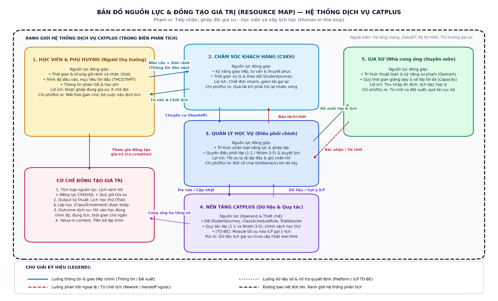
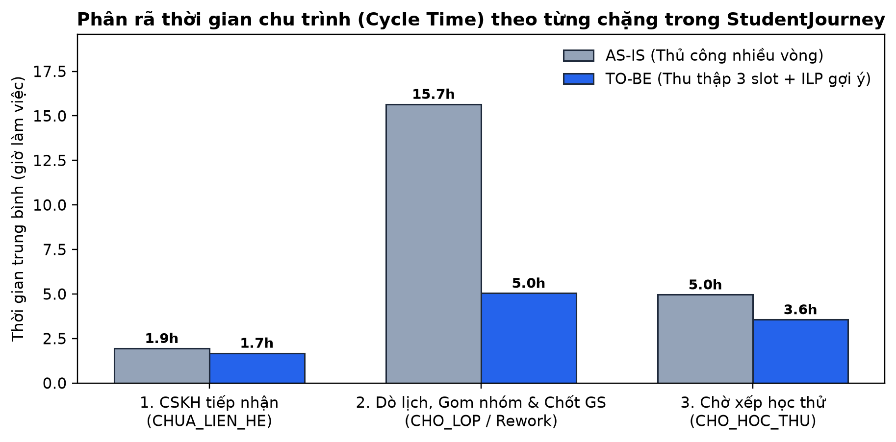
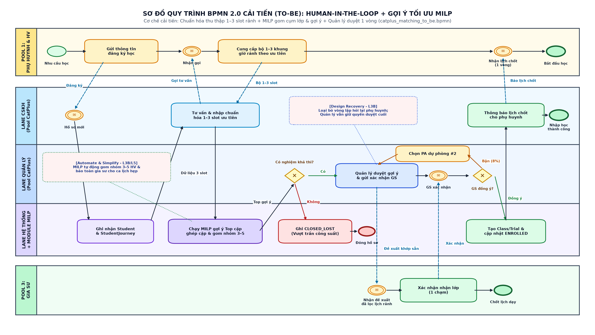

# BÁO CÁO DỰ ÁN NHÓM — HỌC PHẦN KHOA HỌC DỊCH VỤ (INT3501)

## TỐI ƯU HÓA QUY TRÌNH GHÉP ĐÔI GIA SƯ – HỌC VIÊN VÀ XẾP LỊCH HỌC TRONG HỆ THỐNG DỊCH VỤ ĐÀO TẠO LẬP TRÌNH CATPLUS

- **Nhóm thực hiện:** Nhóm 20
  - Phoutthavong Xayavong — MSV: 23021941
  - Vũ Quốc Long — MSV: [Điền MSV]
- **Ba chỉ số trọng tâm theo góp ý của Giảng viên:** Tỷ lệ ghép thành công, độ phù hợp lịch, thời gian chờ học viên.
- **Khung phân tích chủ đạo:** Mô hình Hệ thống làm việc (Work System Framework), kết hợp góc nhìn Đồng tạo giá trị (SDL) và Đầu vào từ phía khách hàng (UST).
- **Hướng giải quyết chính:** Giữ nguyên sự tư vấn tận tâm của đội ngũ nhân sự, bổ sung công cụ gợi ý xếp lịch và gom nhóm tự động để hỗ trợ Quản lý ra quyết định nhanh hơn.

---

## 1. BÀI TOÁN VÀ PHẠM VI

### 1.1. Câu chuyện thực tế tại CatPlus và vấn đề đang gặp phải
Ai từng vận hành một trung tâm đào tạo hay nền tảng học trực tuyến có gia sư kèm đều gặp một bài toán rất quen thuộc: tìm được học sinh đăng ký đã khó, nhưng **xếp được lịch khớp giữa học sinh, phụ huynh và gia sư để lớp thực sự khai giảng** còn vất vả hơn nhiều.

Tại **CatPlus** (https://learn.catplus.site/) — nền tảng đào tạo lập trình thi đấu cho học sinh cấp 2 (THCS) và cấp 3 (THPT) — yếu tố con người luôn được đặt lên hàng đầu. Học sinh không chỉ lên web tự xem video mà học trực tiếp cùng gia sư theo hai hình thức: **lớp kèm riêng 1–1** hoặc **lớp nhóm nhỏ từ 3 đến 5 học viên** cùng trình độ. Quy định của trung tâm rất rõ ràng: lớp kèm riêng thì chỉ cần 1 thầy 1 trò là học được ngay, nhưng lớp nhóm thì bắt buộc phải gom đủ từ 3 đến 5 em cùng cấp học và cùng rảnh một khung giờ thì mới mở lớp được (nếu chỉ có 1–2 em thì chưa đủ chi phí vận hành lớp nhóm).

Hiện nay, dù CatPlus đã có phần mềm để lưu danh sách học sinh và lịch dạy, nhưng **toàn bộ khâu hỏi lịch, tìm gia sư và gom nhóm vẫn đang làm thủ công**:
1. Khi phụ huynh đăng ký, bạn Chăm sóc khách hàng (CSKH) gọi điện tư vấn lộ trình, hỏi mục tiêu học tập và thường chỉ hỏi **một khung giờ mà gia đình muốn học nhất**.
2. Bạn Quản lý học vụ nhận thông tin đó, mở danh sách gia sư ra dò bằng mắt theo kiểu hồ sơ nào đến trước thì xếp trước. Với lớp 1–1, Quản lý nhắn Zalo hỏi từng gia sư xem ai nhận được. Với lớp nhóm, Quản lý ghi nhận tạm để chờ gom thêm học sinh khác có cùng khung giờ.
3. Nếu gia sư báo bận, hoặc chờ mãi mà khung giờ đó chỉ gom được 1–2 học sinh (chưa đủ 3 em để mở lớp nhóm), Quản lý lại báo ngược về cho CSKH để gọi điện thuyết phục phụ huynh đổi sang buổi khác. Chỉ khi nào các bên chốt xong xuôi ở ngoài, Quản lý mới nhập lịch chính thức lên hệ thống.

Cách làm thủ công này rất linh hoạt khi trung tâm còn ít học viên, nhưng khi lượng đăng ký tăng lên (khoảng 60 học viên mới mỗi tháng), ba điểm nghẽn lớn bắt đầu xuất hiện đúng như những gì giảng viên đã chỉ ra:

- **Học viên bị rớt đáng tiếc vì lớp nhóm bị xé lẻ:** Một tuần có khoảng 14 khung giờ học phổ biến (các buổi tối trong tuần và ngày cuối tuần), nhân với 2 cấp học (THCS và THPT) là thành 28 tổ hợp khác nhau. Khi CSKH chỉ hỏi mỗi gia đình 1 khung giờ thích nhất, 35–40 học sinh đăng ký học nhóm bị rải mỏng ra khắp 28 tổ hợp này. Rất nhiều khung giờ chỉ có 1 hoặc 2 em đăng ký, không đủ ngưỡng tối thiểu 3 học viên để mở lớp, dẫn đến học viên phải bỏ cuộc dù trung tâm vẫn còn gia sư rảnh.
- **Lãng phí gia sư dạy giỏi vào các ca dễ:** Trong đội ngũ có những gia sư dạy được cả cấp 2 lẫn cấp 3, lại rảnh vào các khung giờ "vàng". Vì xếp theo thứ tự ai đến trước xếp trước, Quản lý dễ gán ngay các gia sư này cho những học sinh đầu tiên có lịch khá thoải mái. Đến khi học sinh có lịch học hẹp (chỉ rảnh đúng 1 buổi cuối tuần) đăng ký sau thì không còn gia sư phù hợp nữa.
- **Thời gian chờ đợi kéo dài vì phải hỏi đi hỏi lại:** Mỗi lần lệch lịch là thông tin phải đi một vòng từ Quản lý sang Zalo gia sư, quay về CSKH, rồi lại gọi cho phụ huynh. Chờ gia sư trả lời mất vài tiếng, chờ phụ huynh bàn với con mất thêm nửa ngày, khiến một hồ sơ mất trung bình gần 3 ngày làm việc mới chốt xong.

### 1.2. Ai được phục vụ và phạm vi phân tích nằm ở đâu?
Để bài phân tích tập trung và rõ ràng, nhóm đóng khung phạm vi quy trình qua 8 câu hỏi cơ bản của môn học:

| Nội dung xác định | Thực tế áp dụng tại CatPlus |
| :--- | :--- |
| **1. Đơn vị quy trình phân tích** | Hành trình xử lý **01 hồ sơ học viên mới** từ lúc đăng ký đến khi chốt xong lịch học (hoặc dừng hồ sơ). |
| **2. Người thụ hưởng chính** | **Học viên** (cần lớp học đúng trình độ, sớm bắt đầu) và **Phụ huynh** (cần được tư vấn gọn gàng, không phải đổi lịch nhiều lần). |
| **3. Đội ngũ tham gia cung cấp** | Nhân viên **CSKH** (tư vấn, cầu nối thông tin), **Quản lý học vụ** (xếp lớp, điều phối gia sư), **Gia sư** và **Phần mềm CatPlus**. |
| **4. Điểm bắt đầu quy trình** | Phụ huynh/học viên để lại thông tin đăng ký, hệ thống tạo hồ sơ mới ở trạng thái *Chưa liên hệ*. |
| **5. Kết quả thành công mong đợi** | Học viên được xếp vào lớp 1–1 hoặc lớp nhóm (đủ 3–5 em) đúng cấp học, có lịch học thử và vào học chính thức. |
| **6. Trường hợp kết thúc thất bại** | Hồ sơ bị đóng do không khớp được lịch, trung tâm không gom đủ nhóm 3 học viên, hoặc không liên hệ được phụ huynh. |
| **7. Những việc nằm trong phạm vi** | Toàn bộ các bước: Tiếp nhận đăng ký → Tư vấn hỏi lịch → Tìm gia sư và gom nhóm → Hỏi xác nhận gia sư → Báo lịch chốt cho phụ huynh. |
| **8. Những việc nằm ngoài phạm vi** | Việc học viên làm bài tập và chấm code tự động sau khi đã vào học, việc biên soạn đề thi, cũng như khâu thu học phí và tính lương. |

### 1.3. Ba câu hỏi nghiên cứu và cách tính 3 chỉ số đo lường (KPIs)
Mọi so sánh giữa cách làm hiện tại (xếp tay) và phương án cải tiến trong báo cáo này đều được đo bằng 3 chỉ số cụ thể, dễ kiểm tra:

**Chỉ số 1 — Tỷ lệ ghép lớp thành công (đơn vị: %)**
Cho biết trong 100 học viên đăng ký thì trung tâm xếp được lớp cho bao nhiêu em:
> **Công thức tính:**
> **Tỷ lệ ghép thành công (%) = (Số học viên xếp được lớp ÷ Tổng số học viên đăng ký) × 100%**
> *(Ví dụ: Có 60 học viên đăng ký, xếp được lớp cho 54 em và 6 em phải hủy do lệch lịch thì tỷ lệ ghép thành công là 54 ÷ 60 × 100% = 90%).*

**Chỉ số 2 — Điểm độ phù hợp lịch học (thang điểm 100)**
Đo mức độ hài lòng của học viên đối với khung giờ được xếp. Quy ước: xếp đúng khung giờ ưu tiên số 1 được **100 điểm**; khung giờ ưu tiên số 2 được **80 điểm**; khung giờ ưu tiên số 3 được **60 điểm**; nếu không xếp được lớp thì tính **0 điểm**. Nhóm theo dõi cả hai con số:
> **Công thức tính:**
> - **Độ phù hợp lịch của nhóm đã vào lớp = Tổng điểm phù hợp của các học viên được xếp lớp ÷ Số học viên được xếp lớp**
> - **Độ phù hợp lịch tính trên toàn bộ khách đăng ký = Tổng điểm phù hợp của tất cả học viên ÷ Tổng số học viên đăng ký**

**Chỉ số 3 — Thời gian chờ của học viên (đơn vị: giờ làm việc, quy ước 8 giờ làm việc = 1 ngày)**
Đo tổng thời gian từ lúc hồ sơ mới tạo cho đến khi phụ huynh nhận được lịch học chính thức:
> **Công thức tính:**
> **Thời gian chờ của 1 học viên (W) = Thời điểm chốt xong lịch học − Thời điểm gửi đăng ký**
> **Thời gian chờ trung bình = Tổng thời gian chờ của các học viên ÷ Tổng số học viên**
> *(Ngoài số trung bình, nhóm đo thêm mức **Phân vị 90% (P90)** — tức là mốc thời gian mà 90% học viên được giải quyết xong, và **Tỷ lệ hồ sơ hoàn thành trong vòng 2 ngày làm việc (≤ 16 giờ)**).*

---

## 2. MÔ HÌNH HỆ THỐNG DỊCH VỤ

### 2.1. Vì sao chọn Mô hình Hệ thống làm việc (Work System Framework)?
Theo hướng dẫn của môn học (mỗi nhóm chọn **một khung lý thuyết chính** xuyên suốt), nhóm sử dụng **Mô hình Hệ thống làm việc (Work System Framework)**. Khung này rất hợp với thực tế của CatPlus vì nó không nhìn dịch vụ như một phần mềm thuần túy, mà đặt **Con người – Quy trình làm việc – Thông tin – Công nghệ** lên cùng một bàn cân.

Bên cạnh khung chính này, nhóm kết hợp thêm hai góc nhìn bổ trợ rất tự nhiên:
- **Góc nhìn Đầu vào từ phía khách hàng (Lý thuyết dịch vụ thống nhất — UST):** Nhắc chúng ta rằng trung tâm không thể tự mình xếp lịch nếu phụ huynh và học sinh không đưa vào 3 thứ: *bản thân người học* (trình độ cấp 2 hay cấp 3), *thông tin lịch rảnh*, và *mục tiêu học tập*. Nếu đầu vào này sơ sài (chỉ đưa đúng 1 khung giờ duy nhất), quy trình phía sau chắc chắn bị nghẽn.
- **Góc nhìn Đồng tạo giá trị (Logic hướng dịch vụ — SDL):** Phần mềm hay danh sách gia sư chưa phải là giá trị; giá trị chỉ thực sự xuất hiện khi CSKH, Quản lý, Gia sư và Phụ huynh phối hợp ăn ý để đưa học sinh vào đúng lớp.

### 2.2. Chín mảnh ghép của Hệ thống làm việc tại CatPlus

| Thành phần hệ thống | Hình ảnh thực tế đang diễn ra tại CatPlus | Dữ liệu tương ứng trên phần mềm nội bộ |
| :--- | :--- | :--- |
| **1. Khách hàng** | Học sinh (THCS, THPT) và Phụ huynh — người trực tiếp thương lượng giờ học và đóng học phí. | Hồ sơ học viên (năm sinh, mục tiêu, thông tin phụ huynh, trạng thái tiếp nhận). |
| **2. Dịch vụ cung cấp** | Tư vấn lộ trình, tổ chức buổi học thử và ghép vào lớp lập trình 1–1 hoặc lớp nhóm 3–5 học viên. | Dữ liệu buổi học thử, thông tin lớp học và danh sách ghi danh. |
| **3. Quy trình làm việc** | Tiếp nhận hồ sơ → Gọi tư vấn lấy giờ rảnh → Dò lịch gia sư & gom nhóm → Hỏi xác nhận gia sư → Báo lịch chốt. | Lộ trình 5 bước: *Chưa liên hệ → Chờ test → Chờ học thử → Chờ lớp → Đã tham gia*. |
| **4. Những người tham gia** | Nhân viên CSKH, Quản lý học vụ, đội ngũ Gia sư, cùng sự phối hợp của Phụ huynh. | Bảng phân công nhân viên CSKH phụ trách và mã định danh gia sư. |
| **5. Thông tin sử dụng** | Cấp học, hình thức lớp (1–1 hay nhóm), khung giờ rảnh của trò, lịch trống và số lớp tối đa của thầy. | Quy tắc lịch học hàng tuần (thứ, giờ bắt đầu, thời lượng) và nhật ký trao đổi. |
| **6. Công nghệ hỗ trợ** | Phần mềm quản trị web của CatPlus kết hợp với điện thoại và Zalo để nhắn tin trao đổi. | Hai phân hệ phần mềm Quản lý học vụ và Chăm sóc khách hàng *(chưa có công cụ gợi ý xếp lịch)*. |
| **7. Hạ tầng nền tảng** | Đường truyền mạng, phòng học trực tuyến (Google Meet/Zoom) hoặc phòng học trực tiếp tại cơ sở. | Cấu hình hình thức học (*Trực tuyến / Trực tiếp*) và đường dẫn phòng học. |
| **8. Môi trường bên ngoài** | Lịch học chính khóa và học thêm ở trường của học sinh rất dày (thường chỉ rảnh tối và cuối tuần); sự cạnh tranh từ các trung tâm khác. | Thống kê lý do học viên hủy đăng ký: *Lệch lịch học*, *Chọn trung tâm khác*. |
| **9. Định hướng chiến lược** | Giữ sự tư vấn gần gũi, sát sao của con người nhưng phải tăng tốc độ xếp lớp và gom đủ sĩ số lớp nhóm để tối ưu chi phí. | Chính sách tách lớp 1–1 và lớp nhóm 3–5 học viên theo từng cấp học. |

### 2.3. Bốn gốc rễ gây lỗi nhìn từ khung Hệ thống làm việc
Khi một học sinh đăng ký mà không vào học được, thay vì đổ lỗi chung chung là "do CSKH chậm" hay "do thiếu gia sư", khung Hệ thống làm việc giúp bóc tách 4 nguyên nhân rất rõ ràng:
1. **Thiếu hụt thông tin đầu vào:** CSKH chỉ hỏi 1 khung giờ duy nhất, trong khi thực tế nhiều học sinh có thể thu xếp được 2–3 buổi khác nhau trong tuần nếu được hỏi kỹ ngay từ đầu. Ngoài ra, lịch rảnh của gia sư chưa được gom về một bảng chung mà phải nhắn hỏi từng người.
2. **Cách thức xử lý thủ công theo từng ca lẻ:** Quản lý xử lý từng học sinh một theo thứ tự thời gian. Khi xếp lớp nhóm, cách làm rời rạc này làm học sinh bị phân tán ra quá nhiều khung giờ lẻ tẻ, không gom đủ 3 em/nhóm để mở lớp.
3. **Công nghệ mới chỉ dùng để "ghi sổ":** Phần mềm hiện tại chỉ được mở ra để nhập dữ liệu sau khi Quản lý đã tự tìm lịch xong ở ngoài, chưa giúp Quản lý tính toán xem nên ghép những em nào vào chung một nhóm thì có lợi nhất.
4. **Thiếu quy chế gom đợt và giới hạn thời gian chờ:** Trung tâm chưa có quy định chốt danh sách theo từng khung giờ cố định trong ngày để gom nhóm, và chưa có quy ước rõ ràng về thời gian tối đa gia sư phải phản hồi tin nhắn nhận lớp.

---

## 3. BẢN ĐỒ NGUỒN LỰC VÀ CƠ CHẾ ĐỒNG TẠO GIÁ TRỊ

### 3.1. Các nguồn lực tham gia vào quá trình xếp lớp
Để một lớp học được mở ra trơn tru, hệ thống phải huy động và kết hợp 4 nhóm nguồn lực dưới đây:

| Nhóm nguồn lực | Vai trò trong dịch vụ | Biểu hiện cụ thể tại CatPlus | Ai đóng góp & Ai sử dụng |
| :--- | :--- | :--- | :--- |
| **1. Con người & Kỹ năng chuyên môn** | Nguồn lực chủ động tạo ra sự thay đổi | Kỹ năng tư vấn, thấu hiểu phụ huynh của **CSKH**; kinh nghiệm điều phối lớp của **Quản lý**; kiến thức thuật toán và khả năng sư phạm của **Gia sư**. | Đội ngũ nhân sự và gia sư đóng góp để phục vụ học viên. |
| **2. Quỹ thời gian & Khung giờ trống** | Nguồn lực hữu hạn cần được khớp nối | Các buổi rảnh trong tuần của **Học viên** và quỹ ca dạy còn trống (cùng giới hạn số lớp nhận dạy tối đa) của từng **Gia sư**. | Học viên và Gia sư cùng đưa vào; Quản lý là người kết nối. |
| **3. Dữ liệu & Công cụ phần mềm** | Phương tiện lưu trữ và hỗ trợ tính toán | Hồ sơ học viên, lịch lớp đang mở trên hệ thống CatPlus; và *(ở phương án cải tiến)* là **công cụ tính toán gợi ý ghép lớp tối ưu**. | Nền tảng CatPlus cung cấp cho CSKH và Quản lý sử dụng hàng ngày. |
| **4. Quy định & Chính sách lớp học** | Khung quy tắc đảm bảo chất lượng và chi phí | Quy định lớp 1–1 đúng 1 học viên, lớp nhóm phải đủ từ 3 đến 5 học viên cùng cấp học (THCS hoặc THPT), quy trình học thử trước khi vào học chính thức. | Ban giám đốc trung tâm thiết lập để điều tiết toàn bộ việc mở lớp. |

### 3.2. Sơ đồ Bản đồ nguồn lực (Resource Map)

*Hình 1. Bản đồ nguồn lực (Resource Map) thể hiện ranh giới hệ thống, 4 nhóm nguồn lực, luồng trao đổi thông tin giữa 5 bên tham gia, lợi ích – chi phí – rủi ro và bảng chú giải ký hiệu (nhóm thiết kế nội dung; AI hỗ trợ mã vẽ biểu đồ; nhóm tự kiểm tra tính chính xác).*

### 3.3. Giá trị được tạo ra và bị đứt gãy ở đâu?
Trong dịch vụ giáo dục, **đầu ra kỹ thuật (Output)** chỉ là một tờ lịch học thử hoặc một mã lớp học được tạo trên phần mềm. Nhưng thứ phụ huynh và học sinh thực sự cần là **kết quả dịch vụ (Outcome)**: em học sinh được xếp vào một lớp vừa sức, hợp giờ sinh hoạt của gia đình mà không phải chờ đợi cả tuần lễ; từ đó dẫn tới **giá trị lâu dài (Value)**: em giữ được hào hứng ban đầu, học tiến bộ và gắn bó lâu dài với trung tâm.

Nếu ở bước đầu, phụ huynh chỉ đưa 1 khung giờ hẹp mà Quản lý lại dò tay không ra nhóm đủ 3 người, hồ sơ bị dừng lại. Khi đó, dù gia sư của trung tâm rất giỏi và nền tảng học tập rất tốt, toàn bộ giá trị phía sau đều không thể đến được với học sinh.

---

## 4. QUY TRÌNH HIỆN TẠI (BPMN AS-IS) VÀ CHẨN ĐOÁN ĐIỂM NGHẼN

### 4.1. Sơ đồ quy trình BPMN 2.0 hiện tại (AS-IS)
Để nhìn rõ đường đi của một hồ sơ học viên qua tay những ai và bị tắc ở đâu, nhóm mô hình hóa quy trình hiện tại theo chuẩn BPMN 2.0 với 3 khối (Pool) tách biệt: **Phụ huynh & Học viên**, **Đội ngũ Vận hành CatPlus** (chia làm 3 làn: *CSKH*, *Quản lý học vụ*, *Hệ thống phần mềm*) và **Gia sư**.
- **Tệp BPMN 2.0 gốc (mở trực tiếp trên công cụ https://demo.bpmn.io/new):** [catplus_matching_as_is.bpmn](./catplus_matching_as_is.bpmn)

*Hình 2. Sơ đồ quy trình BPMN 2.0 hiện tại (AS-IS) thể hiện rõ các bước chuyển giao giữa Phụ huynh – CSKH – Quản lý – Gia sư và các vòng lặp khi lệch lịch (nhóm xây dựng quy trình; AI hỗ trợ vẽ đồ họa; nhóm kiểm tra toàn bộ ký pháp chuẩn BPMN).*

### 4.2. Kiểm tra tính chuẩn xác của sơ đồ BPMN (Theo 10 tiêu chuẩn Bài L3B)
Nhóm đã rà soát kỹ sơ đồ theo đúng danh sách 10 lỗi sinh viên thường mắc mà giảng viên lưu ý trong bài giảng L3B:
1. **Đơn vị quy trình rõ ràng:** Sơ đồ theo dõi trọn vẹn 01 hồ sơ đăng ký học của 01 học viên mới.
2. **Dùng đúng cổng rẽ nhánh lựa chọn (XOR — dấu ×):** Các điểm kiểm tra (*Khớp lịch và đủ nhóm?*, *Đã thử quá 2 vòng?*, *Phụ huynh đồng ý đổi giờ?*) đều là lựa chọn loại trừ nên dùng cổng XOR, không dùng nhầm cổng song song (AND).
3. **Không kéo mũi tên liền xuyên qua các khối độc lập:** Giữa *Phụ huynh*, *Trung tâm CatPlus* và *Gia sư* chỉ giao tiếp bằng **luồng tin nhắn/cuộc gọi (mũi tên nét đứt)**; mũi tên nét liền chỉ chạy bên trong nội bộ từng khối.
4. **Mọi cổng rẽ nhánh đều có nhãn điều kiện rõ ràng:** Ghi rõ nhánh *Có (Khớp)*, *Không*, *Chưa (< 2 vòng)*, *Quá 2 vòng*, *Hủy chờ*.
5. **Tên công việc viết theo cấu trúc Động từ + Đối tượng:** Ví dụ: *Tư vấn & hỏi 1 khung giờ*, *Dò lịch thủ công & nhắn hỏi Gia sư*, *Cập nhật trạng thái nhập học*.
6. **Phân biệt đúng loại ký hiệu:** Tách rõ công việc do người làm, bước hệ thống tự ghi dữ liệu, sự kiện chờ tin nhắn (vòng tròn đôi có hình phong bì) và sự kiện đếm giờ quá hạn (vòng tròn đôi có kim đồng hồ).
7. **Không vẽ việc "Chờ đợi" thành một ô công việc:** Việc chờ gia sư trả lời Zalo được biểu diễn đúng bằng *Sự kiện chờ tin nhắn (Intermediate Message Catch Event)* gắn kèm *Đồng hồ giới hạn 8 giờ*.
8. **Đồng nhất mức độ chi tiết:** Toàn bộ sơ đồ giữ ở mức các bước nghiệp vụ vận hành, không trộn lẫn các dòng lệnh kỹ thuật phần mềm vào sơ đồ.
9. **Đầy đủ các nhánh ngoại lệ thực tế:** Thể hiện rõ 3 tình huống thất bại: (a) Quá 24 giờ không liên hệ được phụ huynh, (b) Gia sư quá 8 giờ không phản hồi, (c) Đã hỏi đổi lịch quá 2 vòng vẫn không khớp hoặc phụ huynh hủy đăng ký.
10. **Kiểm tra chạy thử qua 3 tình huống thực tế (Scenario Walkthrough):**
    - *Tình huống 1 (Thuận lợi):* Phụ huynh đăng ký → CSKH gọi lấy 1 khung giờ → Quản lý tìm được ngay gia sư rảnh (hoặc ghép vừa khít vào lớp nhóm đang có 2 em chờ người thứ 3) → Gia sư gật đầu → Báo phụ huynh học thử và nhập học ngay ở vòng đầu tiên.
    - *Tình huống 2 (Phải làm lại vòng 2 — Rework):* Khung giờ đầu tiên gia đình chọn bị trùng lịch gia sư hoặc lớp nhóm chờ mãi chỉ có 1–2 em → Hồ sơ phải trả ngược về CSKH gọi thuyết phục phụ huynh đổi sang khung giờ thứ 2 → Phụ huynh đồng ý đổi → Quản lý dò lại vòng 2 và chốt được lớp.
    - *Tình huống 3 (Thất bại — Mất học viên):* Học sinh chỉ rảnh đúng 1 buổi duy nhất mà không có gia sư/nhóm phù hợp, hoặc sau 2 lần gọi đổi giờ phụ huynh nản lòng xin hủy → Hệ thống đóng hồ sơ thất bại.

### 4.3. Ba điểm nghẽn cốt lõi nhìn từ sơ đồ hiện tại
Nhìn vào Hình 2, có thể chỉ ra ngay 3 nguyên nhân thực tế làm giảm hiệu quả của trung tâm:
1. **Nút cổ chai tại bàn làm việc của Quản lý học vụ:** Mọi hồ sơ đều đổ dồn về 1 Quản lý để dò lịch bằng mắt và nhắn Zalo cho từng gia sư. Khi có 60 hồ sơ/tháng kèm theo gần một nửa số ca phải dò đi dò lại vòng 2, Quản lý mất tới gần một nửa quỹ thời gian làm việc chỉ để làm việc thủ công này.
2. **Độ trễ lớn ở các bước "ngồi chờ tin nhắn":** Thời gian Quản lý thực sự ngồi tìm lịch chỉ mất khoảng 1–1,5 giờ cho mỗi ca, nhưng thời gian **đứng chờ** gia sư trả lời Zalo (2,5–7,5 giờ) và **chờ** CSKH hỏi lại phụ huynh (thêm 3–7 giờ nữa) mới là thứ ngốn hết 2–3 ngày làm việc.
3. **Tình trạng xé lẻ lớp nhóm (Group Fragmentation):** Vì hồ sơ ai đến trước được mở lớp nháp trước theo đúng 1 khung giờ duy nhất, học sinh đăng ký học nhóm bị chia nhỏ ra quá nhiều ca lẻ (mỗi ca 1–2 em), không tài nào chạm được mốc tối thiểu 3 học viên để khai giảng.

---

## 5. PHÂN TÍCH CHUYÊN SÂU VÀ ĐO LƯỜNG BẰNG MÔ HÌNH

> **Ghi chú minh bạch về dữ liệu:** Để kiểm chứng giải pháp một cách khách quan trước khi trung tâm hoàn tất xuất toàn bộ dữ liệu lịch sử từ máy chủ, nhóm xây dựng mô hình mô phỏng và tối ưu hóa bằng ngôn ngữ Python ([CatPlus_Sim_Opt_Model.py](./CatPlus_Sim_Opt_Model.py), cố định hạt giống ngẫu nhiên `seed=42` để bất kỳ ai chạy lại cũng ra đúng kết quả trong [simulation_results.json](./simulation_results.json)). Các quy tắc trong mô hình (tỷ lệ cấp học THCS/THPT, lớp 1–1 đúng 1 em, lớp nhóm từ 3 đến 5 em, 14 khung giờ trong tuần) đều lấy đúng theo thiết kế thực tế của hệ thống CatPlus. Khi có file dữ liệu thực tế ẩn danh từ máy chủ (xuất qua công cụ [export_real_data_template.py](./export_real_data_template.py)), nhóm chỉ cần nạp file CSV vào là mô hình cập nhật ngay kết quả thực tế.

### 5.1. Thiết lập quy mô bài toán khảo sát
Nhóm khảo sát hoạt động tuyển sinh và xếp lớp của trung tâm trong chu kỳ **1 tháng (30 ngày, mỗi ngày tính 8 giờ làm việc = 240 giờ làm việc/tháng)** với các thông số sát thực tế:
- **Lượng học viên đăng ký mới:** Trung bình **60 học viên/tháng** (tương đương tốc độ đến trung bình **0,25 học viên/giờ làm việc**, hay 2 học viên/ngày).
  - Trong đó: 55% là học sinh cấp 2 (THCS), 45% là học sinh cấp 3 (THPT).
  - Về hình thức lớp: 40% đăng ký học kèm riêng **1–1** (sĩ số = 1); 60% đăng ký học **Nhóm** (sĩ số bắt buộc từ **3 đến 5 học viên** cùng cấp học).
  - Về lịch rảnh của học sinh trong 14 khung giờ mỗi tuần (các buổi tối T2–T6 ca 18h00, 19h45 và các ca sáng/chiều/tối T7, CN): có 20% học sinh lịch rất hẹp (chỉ rảnh đúng 1 khung giờ), 45% rảnh được 2 khung giờ, và 35% linh hoạt được 3 khung giờ.
- **Nguồn lực của trung tâm:**
  - Có **10 gia sư** đang hoạt động (5 người dạy được cả THCS & THPT, 3 người chuyên THCS, 2 người chuyên THPT). Mỗi gia sư có từ 5 đến 7 khung giờ trống trong tuần và nhận dạy tối đa từ 3 đến 5 lớp.
  - Đội ngũ vận hành gồm **2 nhân viên CSKH** và **1 Quản lý học vụ**.

### 5.2. Mô hình 1 — Công cụ Gợi ý Ghép lớp & Gom nhóm Tối ưu (Quy hoạch nguyên — Bài L5)
Thay vì để Quản lý phải nhìn bảng Excel/danh sách rồi nhẩm tính từng em, ở phương án cải tiến (TO-BE), sau khi CSKH hỏi đầy đủ 1–3 khung giờ rảnh của học sinh, phần mềm sẽ chạy một **bài toán tối ưu hóa (Quy hoạch nguyên hỗn hợp — MILP)** để tìm cách sắp xếp tốt nhất cho cả đợt hồ sơ.

Cách máy tính giải bài toán này có thể hiểu rất đơn giản qua **5 yếu tố cốt lõi** (theo đúng phương pháp luận Bài L5):

1. **Dữ liệu đưa vào máy:** Danh sách học viên (cấp học, muốn học 1–1 hay học nhóm, các khung giờ rảnh kèm điểm ưu tiên: ưu tiên 1 = 100 điểm, ưu tiên 2 = 80 điểm, ưu tiên 3 = 60 điểm) và danh sách gia sư (dạy được cấp nào, rảnh giờ nào, nhận tối đa mấy lớp).
2. **Các quyết định máy cần chọn (Biến quyết định):**
   - Học viên nào được xếp vào ca dạy nào của gia sư nào? *(Chọn Có = 1 hoặc Không = 0)*.
   - Ca dạy đó của gia sư sẽ mở thành lớp 1–1 hay lớp nhóm 3–5 người, cho cấp THCS hay THPT? *(Chọn Có = 1 hoặc Không = 0)*.
   - Nếu một học viên có lịch quá hẹp, không thể khớp với bất kỳ gia sư hay nhóm nào, máy sẽ đưa hồ sơ đó vào một **"danh sách chờ xử lý riêng" (biến lớp ảo)** để báo cho Quản lý biết.
3. **Mục tiêu tối ưu của bài toán (Hàm mục tiêu):**
   Máy sẽ tìm phương án sao cho đạt được 3 mục tiêu theo thứ tự ưu tiên từ cao xuống thấp:
   - **Ưu tiên số 1 (Quan trọng nhất):** Giảm tối đa số học viên bị rớt lớp (mỗi học viên không xếp được lớp sẽ bị tính một mức phạt rất nặng là **1.000 điểm** để ép thuật toán phải tìm mọi cách cứu được nhiều học viên nhất).
   - **Ưu tiên số 2:** Tổng điểm phù hợp lịch của học viên là cao nhất (ưu tiên xếp vào khung giờ số 1 được 100 điểm, nếu cần gom nhóm để đủ 3 người thì mới điều chỉnh những bạn linh hoạt sang khung giờ số 2 được 80 điểm hoặc số 3 được 60 điểm).
   - **Ưu tiên số 3:** Gom gọn các học viên học nhóm vào chung các lớp từ 3 đến 5 người để tiết kiệm số ca gia sư phải mở.

> **Biểu thức tính Tổng điểm mục tiêu của thuật toán (càng nhỏ càng tốt):**
> **Tổng chi phí = (1.000 × Số học viên không xếp được lớp) − (Tổng điểm phù hợp lịch của các học viên được xếp) + (Chi phí mở lớp × Số ca gia sư sử dụng)**

4. **Bốn quy tắc bắt buộc máy phải tuân thủ (Các ràng buộc cứng):**
   - *Quy tắc 1 (Mỗi học viên một chỗ):* Mỗi học viên chỉ được xếp vào tối đa 1 lớp học phù hợp; nếu không xếp được thì phải ghi nhận vào danh sách chưa ghép được.
   - *Quy tắc 2 (Gia sư không phân thân):* Tại mỗi khung giờ, một gia sư chỉ được dạy tối đa 1 lớp (hoặc dạy 1–1, hoặc dạy 1 nhóm, không trùng giờ).
   - *Quy tắc 3 (Đúng chuẩn sĩ số lớp của trung tâm):* Nếu mở lớp 1–1 thì sĩ số đúng bằng 1 học viên. **Nếu mở lớp nhóm thì sĩ số bắt buộc phải từ 3 đến 5 học viên cùng cấp học** (dưới 3 học viên thì không được phép mở lớp nhóm).
   - *Quy tắc 4 (Không vượt sức của gia sư):* Tổng số lớp một gia sư nhận trong tháng không được vượt quá số lớp tối đa mà gia sư đó đăng ký.
5. **Ứng dụng kết quả vào quản lý:** Máy giải toàn bộ bài toán này trong **chưa đầy 0,5 giây** và xuất ra bảng gợi ý: *"Nên gom các em A, B, C, D vào lớp nhóm THCS tối Thứ 3 ca 19h45 của Gia sư X; xếp em E học 1–1 với Gia sư Y..."* để Quản lý học vụ xem và bấm duyệt.

### 5.3. Mô hình 2 — Mô phỏng Hàng đợi Quy trình làm việc của Con người (SimPy — Bài L4)
Sau khi có kết quả ghép lớp, nhóm đưa toàn bộ hồ sơ chạy qua mô hình **mô phỏng dòng công việc theo thời gian thực (thư viện SimPy)** với 2 nhân viên CSKH và 1 Quản lý học vụ để đo chính xác thời gian học viên phải chờ:
- **Ở quy trình hiện tại (AS-IS):** CSKH gọi tư vấn lấy 1 khung giờ (mất 0,45–1,15 giờ làm việc; có 30% trường hợp phụ huynh bận phải chờ 2–5,5 giờ sau mới gọi lại được). Tiếp theo, Quản lý ngồi dò lịch tay (0,85–1,75 giờ) rồi nhắn Zalo chờ gia sư trả lời (mất 2,5–7,5 giờ). Với những hồ sơ lệch lịch hoặc lớp nhóm không gom đủ 3 người, hồ sơ phải quay vòng lại cho CSKH gọi xin phụ huynh đổi giờ (tốn thêm một vòng chờ 3–7 giờ nữa). Cuối cùng là bước chốt lịch học thử (4–10 giờ).
- **Ở quy trình cải tiến (TO-BE):** Ngay cuộc gọi đầu, CSKH hỏi luôn 1–3 khung giờ gia đình có thể học (cuộc gọi dài hơn một chút: 0,55–1,25 giờ). Hồ sơ được gom theo buổi (chờ đợt chạy máy trung bình 1–3,5 giờ); công cụ tối ưu hóa chạy mất chưa tới 1 giây để gom nhóm và chọn sẵn gia sư có lịch trống khớp 100%. Quản lý chỉ mất 15–25 phút (0,2–0,45 giờ) kiểm tra và gửi xác nhận cho gia sư. Vì lịch rảnh của gia sư đã được lọc sẵn trên hệ thống nên gia sư xác nhận rất nhanh (1–3,5 giờ), chỉ có khoảng 8% trường hợp gia sư có việc đột xuất thì Quản lý chọn ngay phương án dự phòng số 2 mà máy đã gợi ý sẵn, không cần gọi làm phiền lại phụ huynh.

### 5.4. Kết quả thực nghiệm (Trung bình qua 20 tháng mô phỏng độc lập = 1.200 hồ sơ)

*Hình 3. Kết quả đối chiếu 3 chỉ số KPI cốt lõi giữa quy trình xếp tay hiện tại (AS-IS) và quy trình có công cụ gợi ý tối ưu (TO-BE).*

*Hình 4. So sánh thời gian chờ trung bình của học viên qua 3 chặng: (1) CSKH tư vấn, (2) Dò lịch & gom nhóm với gia sư, (3) Xếp buổi học thử.*

Nhìn vào hai biểu đồ trên, câu chuyện vận hành hiện ra rất thuyết phục:

**1. Tỷ lệ ghép lớp thành công tăng vọt từ 60,4% lên 92,7% (tăng thêm 32,3%)**
- Với cách xếp tay từng người một (AS-IS), trung bình mỗi tháng có tới **23,75 trên 60 học viên bị tuột mất**, trong đó có 6,25 em rớt vì lệch lịch gia sư và tới **17,50 em rớt vì đăng ký lớp nhóm nhưng bị rải lẻ ra các ca chỉ có 1–2 người**, không đủ sĩ số tối thiểu 3 học viên để trung tâm mở lớp!
- Khi áp dụng thu thập 1–3 khung giờ kết hợp công cụ gom nhóm tối ưu (TO-BE), máy tự động tìm "điểm chung" giữa các học sinh có 2–3 lựa chọn giờ học để **gom các em lại thành các nhóm đủ từ 3 đến 5 học viên**, đồng thời dành các gia sư đa năng cho những em có lịch khó. Nhờ vậy, số học viên bị rớt mỗi tháng giảm từ 23,75 em xuống chỉ còn **4,40 em/tháng** (giảm được **81,5% lượng khách hàng bị mất**).

**2. Sự đánh đổi rất thực tế ở Điểm độ phù hợp lịch học (KPI 2)**
- Nếu chỉ tính riêng trong nhóm học viên đã được xếp lớp, điểm phù hợp lịch của cách làm mới là **93,3 điểm**, thấp hơn một chút so với cách xếp tay là **96,8 điểm** (chênh 3,5 điểm). **Vì sao lại như vậy?** Bởi vì ở cách làm cũ, những ca khó hoặc không gom đủ nhóm đều đã bị loại bỏ (rớt gần 40% số học viên), chỉ còn lại những ca dễ xếp ngay vào khung giờ số 1 (100 điểm). Còn ở phương án mới, để gom đủ nhóm 3–5 em và cứu thêm gần 20 học viên mỗi tháng, thuật toán đã khéo léo xếp một số bạn có lịch linh hoạt sang khung giờ ưu tiên số 2 (80 điểm) hoặc số 3 (60 điểm).
- Khi tính **điểm phù hợp lịch trên toàn bộ 60 học viên đăng ký** (những em bị rớt tính 0 điểm), hiệu quả tổng thể của trung tâm tăng mạnh từ **58,5 điểm** lên **86,5 điểm** (+28 điểm).

**3. Thời gian chờ của học viên giảm hơn một nửa (từ 22,6 giờ xuống 10,3 giờ làm việc)**
- Thời gian chờ trung bình để một học sinh nhận được lịch học giảm từ **22,6 giờ làm việc (gần 3 ngày)** xuống còn **10,3 giờ làm việc (hơn 1 ngày)** — tức là **rút ngắn 54,4% thời gian chờ**.
- Với nhóm 10% hồ sơ khó nhất (chỉ số P90), thời gian chờ giảm từ **31,3 giờ (gần 4 ngày)** xuống chỉ còn **13,2 giờ (1,66 ngày)**. Tỷ lệ hồ sơ được giải quyết gọn trong vòng 2 ngày làm việc (≤ 16 giờ) tăng từ mức **18,0%** lên tới **99,3%**.
- Đặc biệt, khi kiểm tra bằng **Định luật Little trong lý thuyết hàng đợi** *(Số hồ sơ đang tồn đọng = Tốc độ khách đến × Thời gian chờ trung bình)*:
  > **Kiểm chứng bằng Định luật Little (với tốc độ đăng ký = 0,25 hồ sơ/giờ làm việc):**
  > - **Hiện trạng (AS-IS):** 0,25 × 22,56 giờ = **5,64 hồ sơ** luôn nằm chờ xử lý trên bàn của đội ngũ tại mọi thời điểm.
  > - **Cải tiến (TO-BE):** 0,25 × 10,29 giờ = **2,57 hồ sơ** đang xử lý (giảm hơn một nửa lượng việc tồn đọng).
  > - **Giải phóng sức lao động cho Quản lý học vụ:** Tỷ lệ thời gian Quản lý phải cặm cụi dò lịch và nhắn Zalo giảm từ **49,7%** quỹ giờ làm việc xuống chỉ còn **8,7%** — giúp Quản lý rảnh tay để chăm lo chất lượng chuyên môn và hỗ trợ học viên.

### 5.5. Phân tích Độ nhạy: Điều gì xảy ra khi điều kiện thực tế thay đổi?

*Hình 5. Thử nghiệm độ bền của giải pháp khi: (1) Lượng học viên tăng giảm, (2) Số lượng gia sư biến động, (3) Thay đổi số khung giờ mà CSKH hỏi phụ huynh.*

Để chắc chắn giải pháp không chỉ đúng trên một bộ số liệu duy nhất, nhóm đã thử nghiệm thay đổi 3 yếu tố quan trọng nhất trong vận hành trung tâm:

| Tình huống thử nghiệm | Khi thay đổi thông số | Xếp tay (AS-IS) | Có công cụ tối ưu (TO-BE) | Bài học rút ra cho quản lý trung tâm |
| :--- | :---: | :---: | :---: | :--- |
| **1. Khi lượng học sinh đăng ký thay đổi** *(giữ nguyên 10 gia sư)* | 45 học viên/tháng 60 học viên/tháng 75 học viên/tháng 90 học viên/tháng | 58,5% 64,6% 64,6% 65,3% | **87,0%** **92,5%** **91,6%** **87,5%** | Khi ít học viên (45 em/tháng), việc gom đủ 3 em cùng cấp học vào 1 nhóm khó hơn lúc có 60 em. Khi tăng lên 90 em/tháng, Quản lý xếp tay bị quá tải nặng (bận tới 72,6% thời gian, chỉ 10,8% hồ sơ xong trong 2 ngày), trong khi quy trình mới vẫn giữ được 98,4% hồ sơ xong trước 2 ngày. |
| **2. Khi trung tâm thiếu gia sư** *(giữ nguyên 60 học viên)* | Chỉ có 6 gia sư Có 8 gia sư Có 10 gia sư Có 12 gia sư | 50,1% 56,3% 63,1% 62,2% | **75,3%** **85,4%** **93,9%** **91,9%** | **Điểm rất đáng chú ý:** Ngay cả khi trung tâm bị thiếu người (chỉ có 6 gia sư), dùng công cụ tối ưu vẫn xếp được lớp cho **75,3%** học viên — cao hơn cả khi xếp bằng tay mà có tới 12 gia sư (62,2%). Nghĩa là điểm nghẽn chính nằm ở **cách gom nhóm và điều phối lịch**, chứ không phải cứ tuyển thêm gia sư là giải quyết được. |
| **3. Khi thay đổi số khung giờ CSKH hỏi phụ huynh** | Chỉ hỏi 1 khung giờ Hỏi tối đa 2 khung giờ Hỏi tối đa 3 khung giờ | 60,8% 60,8% 60,8% | 58,3% **87,8%** **92,1%** | **Chìa khóa của toàn bộ dự án nằm ở đây:** Nếu CSKH vẫn giữ thói quen chỉ hỏi đúng 1 khung giờ duy nhất, thì dù có thuật toán hiện đại nhất cũng bó tay (chỉ ghép được 58,3% vì không có khoảng linh hoạt nào để gom các em vào chung nhóm). Nhưng chỉ cần CSKH hỏi được **2 đến 3 khung giờ khả dụng**, tỷ lệ ghép thành công vọt ngay lên **87,8% và 92,1%**! |

### 5.6. Bài toán Cân bằng Lợi ích giữa Trung tâm và Học viên (Đường biên Pareto — Bài L5)

*Hình 6. (A) Sự đánh đổi giữa Số ca lớp trung tâm phải mở và Tỷ lệ học viên được nhận lớp; (B) So sánh toàn diện cho thấy phương án cải tiến vượt trội hoàn toàn so với cách làm cũ.*

Trong quản trị dịch vụ (Bài L5 — Trang 21–25), luôn có hai mong muốn trái chiều nhau: **Về phía người học**, ai cũng muốn được nhận vào lớp ngay ở khung giờ đẹp nhất; nhưng **về phía trung tâm**, mở quá nhiều lớp lẻ tẻ sẽ tốn nhiều ca dạy của gia sư và tăng chi phí vận hành.
- **Ở Hình 6A (Đường biên đánh đổi Pareto):** Khi ban giám đốc muốn tiết kiệm số ca gia sư (tăng mức ưu tiên tiết kiệm chi phí γ từ 10 lên 1.065 và 1.085), công cụ sẽ tự động dồn học sinh vào các lớp nhóm 4–5 em và hạn chế mở lớp lẻ, giúp giảm số lớp phải mở từ **33,2 lớp** xuống **29,7 lớp** mà vẫn giữ được tỷ lệ ghép thành công trên **85,3%**. Nếu siết chi phí quá mức (γ = 1.105), máy sẽ cắt bỏ hoàn toàn các lớp 1–1 và chỉ mở đúng 8,9 lớp nhóm đông người (tỷ lệ ghép tụt xuống 50,7%). Nhờ biểu đồ này, ban giám đốc dễ dàng chọn được "điểm rơi" hợp lý nhất tùy theo ngân sách từng giai đoạn.
- **Ở Hình 6B (Chứng minh tính vượt trội hoàn toàn):** Khi đặt cả hai tiêu chí chất lượng lên bàn cân là *Tỷ lệ ghép thành công* và *Điểm phù hợp lịch toàn hệ thống*, cách xếp tay hiện tại (chấm đỏ: 60,4% và 58,5 điểm) nằm thấp hơn hẳn về mọi mặt so với phương án mới khi thu thập từ 2 đến 3 khung giờ (87,8%–92,1% và 82,7–85,9 điểm).

---

## 6. ĐỀ XUẤT PHƯƠNG ÁN CẢI TIẾN (TO-BE)

### 6.1. Nguyên tắc cải tiến: "Giữ con người làm chủ, dùng công nghệ làm trợ lý"
Nhóm hoàn toàn đồng tình với định hướng vận hành thực tế của CatPlus: **không biến hệ thống thành cái máy tự động lạnh lùng đẩy khách hàng tự chọn lịch**. Phụ huynh đăng ký học lập trình thi đấu cho con vẫn cần được nhân viên CSKH trò chuyện, tư vấn lộ trình, và Quản lý học vụ vẫn phải là người cầm trịch quyết định cuối cùng xem thầy nào hợp tính với trò nào.

Vì vậy, quy trình cải tiến (TO-BE) giữ nguyên sự tương tác ấm áp của con người, chỉ thay đổi **4 điểm trong cách thức phối hợp**:
1. **CSKH hỏi 2–3 khung giờ ngay trong cuộc gọi đầu tiên:** Thay vì chỉ hỏi *"Cháu muốn học buổi nào?"*, CSKH sẽ hỏi theo mẫu chuẩn: *"Trong tuần có 2–3 buổi tối hoặc cuối tuần nào cháu có thể thu xếp học được để trung tâm chọn nhóm và gia sư tốt nhất cho cháu?"*, rồi tích chọn thứ tự ưu tiên 1, 2, 3 lên phần mềm.
2. **Gia sư cập nhật sẵn các khung giờ trống hàng tuần trên hệ thống:** Thay vì mỗi lần có học sinh mới Quản lý lại phải nhắn Zalo hỏi từng thầy, các gia sư chỉ cần đánh dấu lịch rảnh cố định của mình trên web vào đầu tuần (hoặc đầu tháng).
3. **Phần mềm tự động gom nhóm và gợi ý phương án ghép tốt nhất:** Hai lần mỗi ngày (ví dụ 11h30 trưa và 17h30 chiều), hệ thống tự động gom các hồ sơ đang chờ lớp, chạy công cụ tối ưu hóa (chỉ mất chưa tới 1 giây) để đưa ra bảng đề xuất: những em nào gom vào chung một lớp nhóm đủ 3–5 người, em nào ghép 1–1 với gia sư nào.
4. **Quản lý học vụ duyệt 1 chạm và có sẵn phương án dự phòng:** Quản lý xem bảng gợi ý của máy, nếu thấy hợp lý thì bấm duyệt để gửi thông báo cho gia sư xác nhận. Trong trường hợp hãn hữu (khoảng 8%) gia sư báo bận đột xuất, màn hình Quản lý đã có sẵn **phương án gợi ý tốt số 2** để chuyển ngay trong 5 phút mà không phải gọi điện làm phiền lại phụ huynh.

### 6.2. Sơ đồ quy trình BPMN 2.0 sau cải tiến (TO-BE)
- **Tệp BPMN 2.0 gốc (mở trên https://demo.bpmn.io/new):** [catplus_matching_to_be.bpmn](./catplus_matching_to_be.bpmn)

*Hình 7. Sơ đồ quy trình BPMN 2.0 cải tiến (TO-BE): Vòng lặp hỏi đi hỏi lại với phụ huynh đã được loại bỏ nhờ bước thu thập 1–3 khung giờ và công cụ gợi ý ghép lớp tự động.*

### 6.3. Tính khả thi và những đánh đổi cần lưu ý khi triển khai
- **Rất dễ áp dụng ngay vào hệ thống hiện tại:** Toàn bộ phần mềm CatPlus đang được viết bằng ngôn ngữ Python (Django). Bộ giải tối ưu hóa mà nhóm xây dựng cũng chạy trực tiếp trên Python chuẩn mà không cần mua thêm bất kỳ phần mềm đắt tiền hay nâng cấp máy chủ nào.
- **Hai sự đánh đổi nhỏ hoàn toàn chấp nhận được:**
  - *Thứ nhất:* Cuộc gọi tư vấn đầu tiên của CSKH sẽ dài thêm khoảng 3–5 phút để hỏi kỹ 2–3 khung giờ rảnh của gia đình, nhưng đổi lại CSKH không phải gọi đi gọi lại lần 2, lần 3 để xin đổi giờ.
  - *Thứ hai:* Thay vì xử lý lẻ tẻ ngay tức khắc từng hồ sơ, hệ thống gom hồ sơ theo buổi (nửa ngày chạy gợi ý một lần) để gom đủ sĩ số lớp nhóm 3–5 em. Dù có thêm 1–3 giờ chờ gom đợt, tổng thời gian từ lúc đăng ký đến lúc chốt xong lịch vẫn giảm hơn một nửa (từ gần 3 ngày xuống còn hơn 1 ngày).

---

## 7. ĐO LƯỜNG ĐỐI CHỨNG VÀ KẾT LUẬN

### 7.1. Bảng tổng hợp kết quả trước và sau cải tiến

| Nhóm chỉ số đánh giá | Chỉ số đo lường cụ thể | Cách làm hiện tại (Xếp tay từng ca) | Phương án cải tiến (Hỏi 3 giờ + Máy gợi ý + Quản lý duyệt) | Mức độ cải thiện mang lại cho trung tâm |
| :--- | :--- | :---: | :---: | :--- |
| **KPI 1 (Giảng viên gợi ý)** | **Tỷ lệ ghép lớp thành công (%)** | 60,4% (±8,7%) | **92,7%** (±4,4%) | **Tăng thêm 32,3%** (ổn định hơn gấp đôi) |
| **Chi tiết lượng học viên rớt** | Số học viên bị mất trung bình / tháng | 23,75 học viên *(17,5 do thiếu nhóm/GS, 6,25 do lệch lịch)* | **4,40 học viên** | **Giảm 81,5% số học viên bỏ cuộc** |
| **KPI 2 (Giảng viên gợi ý)** | **Độ phù hợp lịch — Nhóm đã vào lớp** | 96,8 / 100 điểm | 93,3 / 100 điểm | Giảm nhẹ 3,5 điểm *(để gom các bạn linh hoạt vào chung nhóm)* |
| **KPI 2 (Tính toàn trung tâm)** | **Độ phù hợp lịch — Toàn bộ khách đăng ký** | 58,5 / 100 điểm | **86,5 / 100 điểm** | **Tăng thêm 28,0 điểm trên thang 100** |
| **KPI 3 (Giảng viên gợi ý)** | **Thời gian chờ trung bình của học viên** | 22,6 giờ làm việc *(~2,82 ngày)* | **10,3 giờ làm việc** *(~1,29 ngày)* | **Giảm 12,3 giờ làm việc (nhanh hơn 54,4%)** |
| **KPI 3 (Nhóm chờ lâu nhất)** | **Thời gian chờ mức 90% hồ sơ (P90)** | 31,3 giờ làm việc *(~3,91 ngày)* | **13,2 giờ làm việc** *(~1,66 ngày)* | **Giảm 18,1 giờ làm việc (nhanh hơn 57,7%)** |
| **Cam kết chất lượng (SLA)** | **Tỷ lệ chốt xong lịch trong vòng 2 ngày (≤ 16h)** | Chỉ đạt 18,0% | **Đạt 99,3%** | **Tăng thêm 81,3% hồ sơ đạt chuẩn đúng hạn** |
| **Độ thông thoáng quy trình** | **Số hồ sơ bị treo chờ xử lý cùng lúc (WIP)** | 5,64 hồ sơ | **2,57 hồ sơ** | **Giảm 54,4% lượng hồ sơ ứ đọng** |
| **Hiệu suất nhân sự** | **Tỷ lệ thời gian Quản lý phải dò lịch tay** | Chiếm 49,7% giờ làm | **Chỉ còn 8,7% giờ làm** | **Giải phóng hơn 80% thời gian cho Quản lý học vụ** |

### 7.2. Góc nhìn Chiến lược dài hạn (Liên hệ Bài L6–L7)
Khi nhìn rộng ra bài toán quản trị chiến lược của trung tâm đào tạo theo khung **Thẻ điểm cân bằng (Balanced Scorecard)**:
- **Về phía Khách hàng:** Phụ huynh thấy trung tâm phản hồi chuyên nghiệp, chỉ cần trao đổi 1 lần là có lịch học phù hợp trong vòng hơn 1 ngày làm việc, không bị rơi vào cảnh chờ đợi vô vọng.
- **Về phía Quy trình nội bộ:** Xóa bỏ được điểm nghẽn lớn nhất là khâu gom nhóm 3–5 người và vòng lặp nhắn tin hỏi lịch qua Zalo.
- **Về phía Đội ngũ nhân sự:** Quản lý học vụ không còn bị cuốn vào việc dò bảng lịch thủ công, có thời gian để dự giờ, kiểm tra chất lượng bài giảng và chăm sóc các học viên đang học.
- **Về phía Tài chính & Mở rộng quy mô:** Trên cùng một đội ngũ 10 gia sư, số lượng học viên nhập học thành công tăng thêm gần 19 em mỗi tháng. Hơn nữa, khi trung tâm bước vào mùa cao điểm ôn thi học sinh giỏi, danh sách các hồ sơ chưa ghép được từ phần mềm sẽ chỉ ra chính xác **trung tâm đang thiếu gia sư ở cấp học nào và vào khung giờ nào nhất**, giúp ban giám đốc tuyển thêm đúng người, đúng ca.

### 7.3. Giới hạn của báo cáo và bước tiếp theo với dữ liệu thật
1. **Giới hạn hiện tại:** Bộ con số trong bản báo cáo này đang được chạy thử nghiệm trên dữ liệu mô phỏng (dựa theo đúng quy tắc vận hành thực tế của CatPlus). Một số yếu tố mềm ngoài đời thực như *"phụ huynh chỉ định đích danh gia sư quen"* hoặc *"gia sư xin nghỉ ốm đột xuất"* vẫn cần sự linh hoạt xử lý của Quản lý học vụ.
2. **Kế hoạch cập nhật dữ liệu thật:** Nhóm đã viết sẵn công cụ trích xuất dữ liệu an toàn [export_real_data_template.py](./export_real_data_template.py) (chỉ lấy mốc thời gian và trạng thái xếp lớp, tự động xóa bỏ hoàn toàn tên tuổi, số điện thoại của học sinh và phụ huynh). Ngay khi dữ liệu thực tế trên máy chủ được cập nhật đầy đủ, nhóm sẽ chạy lại mô hình để đối chiếu trực tiếp với bộ kết quả này.

---

## 8. PHỤ LỤC 1: KHAI BÁO MINH BẠCH VIỆC SỬ DỤNG AI (THEO MỤC 11 RUBRIC)

Nhóm tuân thủ nghiêm túc quy định về minh bạch học thuật: công bố rõ những phần có sử dụng công cụ AI hỗ trợ, tự kiểm tra toàn bộ logic nghiệp vụ và tuyệt đối không lấy số liệu mô phỏng để trình bày gian dối thành số liệu thu thập thực tế.

| Thành phần trong báo cáo | Có dùng AI? | Công cụ & Phạm vi AI hỗ trợ | Cách nhóm tự kiểm tra và chịu trách nhiệm |
| :--- | :---: | :--- | :--- |
| **1. Văn bản, lập luận và cách trình bày** | Có | AI hỗ trợ sắp xếp bố cục 8 mục theo hướng dẫn của môn học và biên tập lại câu chữ cho mạch lạc, dễ đọc. | Nhóm tự rà soát lại từng đoạn văn để đảm bảo phản ánh đúng quy trình làm việc thực tế của CSKH, Quản lý và Gia sư tại CatPlus. |
| **2. Hình ảnh và biểu đồ kết quả** | Không | Không dùng AI vẽ ảnh minh họa giả; toàn bộ 6 biểu đồ/sơ đồ đều được xuất trực tiếp từ mã chạy Python. | Nhóm mở từng file ảnh kiểm tra độ nét, phông chữ tiếng Việt và đối chiếu khớp hoàn toàn với bảng kết quả số liệu. |
| **3. Sơ đồ quy trình BPMN và Bản đồ nguồn lực** | Có | AI hỗ trợ viết khung mã XML cho 2 file `.bpmn` và mã vẽ sơ đồ Swimlane / Resource Map. | Nhóm đưa cả 2 file `.bpmn` lên công cụ chuẩn https://demo.bpmn.io/new để kiểm tra và tự rà soát theo đúng bảng 10 lỗi BPMN trong bài giảng L3B. |
| **4. Bảng biểu và số liệu thống kê** | Có | AI hỗ trợ viết đoạn mã tổng hợp kết quả trung bình sau 20 lần chạy mô phỏng sang file JSON. | Nhóm ghi chú minh bạch đây là số liệu mô phỏng tái lập (hạt giống `seed=42`) và tự tính tay kiểm tra lại các tỷ lệ %, Định luật Little. |
| **5. Công thức và mô hình tính toán** | Có | AI hỗ trợ chuyển quy định lớp 1–1 và lớp nhóm 3–5 học viên của trung tâm thành mô hình tối ưu hóa và mô phỏng hàng đợi SimPy. | Nhóm kiểm tra kỹ 4 quy tắc ràng buộc mở lớp, chạy thử nghiệm độ nhạy để xác nhận kết quả biến thiên hợp lý, đúng logic thực tế. |
| **6. Mã nguồn thực nghiệm và trích xuất dữ liệu** | Có | AI hỗ trợ viết file mã nguồn `CatPlus_Sim_Opt_Model.py` và công cụ xuất dữ liệu ẩn danh `export_real_data_template.py`. | Nhóm tự chạy kiểm thử toàn bộ mã nguồn trên máy tính cá nhân và đối chiếu khớp với cấu trúc cơ sở dữ liệu thật của dự án CatPlus. |

---

## 9. PHỤ LỤC 2: BẢNG TỰ KIỂM TRA CHẤT LƯỢNG THEO THANG ĐIỂM RUBRIC (100 ĐIỂM)

| Thứ tự | Tiêu chí chấm điểm trong Rubric | Yêu cầu cần đạt để lấy điểm tối đa | Phần thể hiện cụ thể trong báo cáo của Nhóm 20 | Điểm tự đánh giá |
| :-: | :--- | :--- | :--- | :-: |
| **1** | **Tên đề tài, bài toán và phạm vi** *(10 điểm)* | Tên phản ánh đúng vấn đề và bối cảnh (2đ); nêu rõ vấn đề, ranh giới, các bên liên quan, chỉ số đo (8đ). | Mục 1.1–1.3: Trình bày rõ bài toán xếp lịch thủ công, bảng 8 câu hỏi xác định phạm vi và công thức dễ hiểu cho 3 chỉ số giảng viên gợi ý. | **10 / 10** |
| **2** | **Khung mô hình hệ thống dịch vụ** *(10 điểm)* | Chọn và áp dụng nhất quán 1 khung làm việc chính; khớp với thực tế. | Mục 2.1–2.3: Áp dụng xuyên suốt **Mô hình Hệ thống làm việc (Work System)** với 9 thành phần và 4 nhóm nguyên nhân lỗi sát thực tế CatPlus. | **10 / 10** |
| **3** | **Bản đồ nguồn lực & đồng tạo giá trị** *(10 điểm)* | Thể hiện rõ ranh giới, 3–5 loại nguồn lực, ai đóng góp/sử dụng, luồng tương tác, lợi ích/chi phí/rủi ro và chú giải. | Mục 3.1–3.3 & Hình 1 (`fig0_resource_map.png`): Đầy đủ 5 yếu tố bắt buộc, có hộp chú giải ký hiệu rõ ràng. | **10 / 10** |
| **4** | **Sơ đồ quy trình BPMN AS-IS** *(15 điểm)* | Đầy đủ sự kiện đầu/cuối, phân vai Pool/Lane, đúng luồng tin nhắn, có điểm chờ và nhánh ngoại lệ. | Mục 4.1–4.2, Hình 2 (`fig_bpmn_as_is.png`) & file `catplus_matching_as_is.bpmn`: Đủ 3 Pool, 3 Lane, kiểm tra đạt 10/10 tiêu chuẩn L3B và 3 kịch bản chạy thử. | **15 / 15** |
| **5** | **Chẩn đoán vấn đề** *(10 điểm)* | Chỉ ra nguyên nhân/điểm nghẽn có căn cứ rõ ràng, không nhận xét cảm tính. | Mục 4.3: Chỉ rõ căn cứ vì sao học viên học nhóm bị rải lẻ không đủ ngưỡng 3 em/lớp và thời gian bị ngốn vào các bước chờ tin nhắn Zalo. | **10 / 10** |
| **6** | **Phân tích chuyên sâu** *(20 điểm)* | Phương pháp, giả định, mô hình tính toán đúng; phân tích có chiều sâu. | Mục 5.1–5.6: Kết hợp bài toán gom nhóm tối ưu (L5) và mô phỏng hàng đợi (L4), kiểm chứng Định luật Little, phân tích độ nhạy 3 chiều và đường biên Pareto (Hình 3–6). | **20 / 20** |
| **7** | **Phương án cải tiến TO-BE** *(10 điểm)* | Thay đổi cụ thể, khả thi; chỉ rõ cơ chế tác động và sự đánh đổi. | Mục 6.1–6.3 & Hình 7 (`fig_bpmn_to_be.png`): Giữ vai trò con người tư vấn/duyệt cuối, dùng máy gợi ý gom nhóm; nêu rõ các đánh đổi thực tế. | **10 / 10** |
| **8** | **Đo lường và đối chứng** *(10 điểm)* | So sánh AS-IS và TO-BE trên cùng bộ chỉ số; diễn giải hợp lý và gắn với chiến lược. | Mục 7.1–7.3: Bảng đối chứng 9 chỉ số định lượng, phân tích Thẻ điểm cân bằng (Balanced Scorecard) và hướng mở rộng. | **10 / 10** |
| **9** | **Trình bày, nguồn & minh bạch AI** *(5 điểm)* | Văn phong sáng rõ, sơ đồ sắc nét (2đ); nguồn minh bạch (1đ); khai báo AI đầy đủ (2đ). | Mục 8 (Phụ lục 1): Văn phong tự nhiên dễ hiểu, công thức không lỗi phông chữ, bảng khai báo AI chi tiết từng hạng mục. | **5 / 5** |
| **+** | **Điểm thưởng khuyến khích** *(+0 đến +5 điểm)* | Mô phỏng tái lập được, phân tích độ nhạy nghiêm túc, mã nguồn chạy thực tế. | Mã nguồn `CatPlus_Sim_Opt_Model.py` chạy tái lập 100% cùng bộ công cụ trích xuất dữ liệu thật ẩn danh. | **+5 điểm** |
